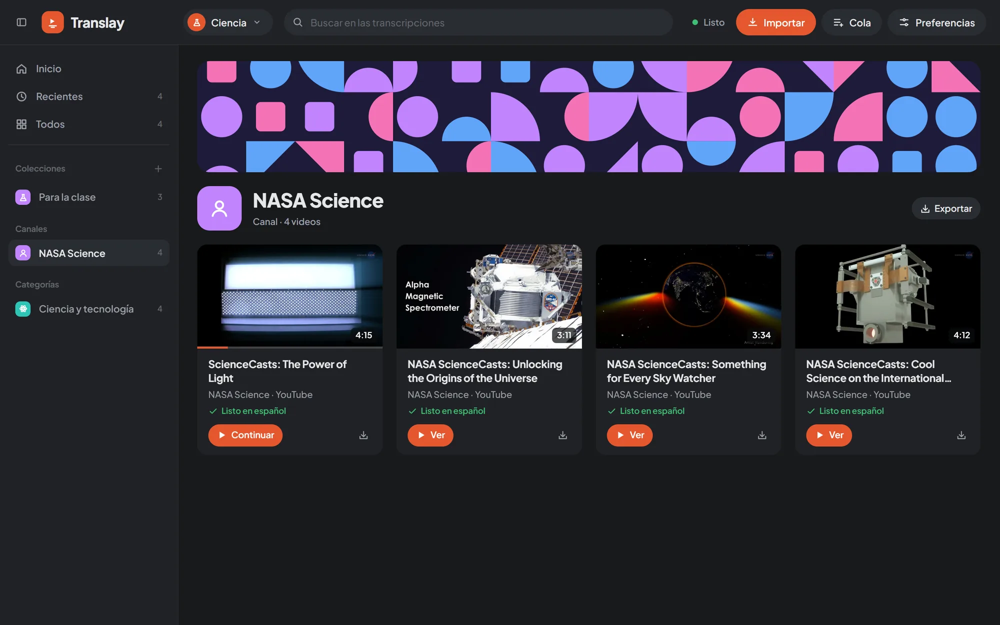
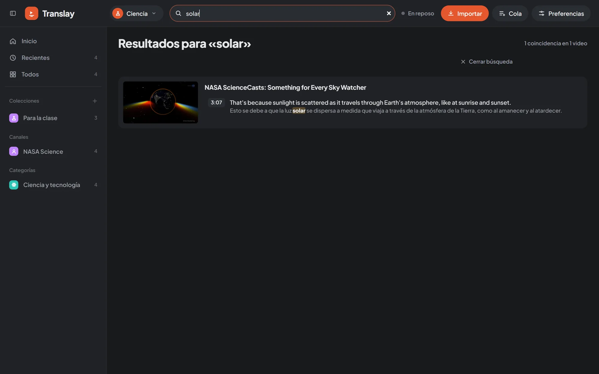
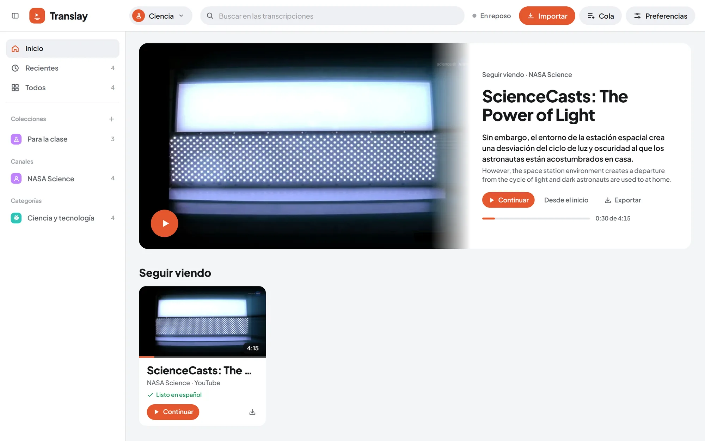

<h1>
  <picture>
    <source media="(prefers-color-scheme: dark)" srcset="assets/translay-logo-oscuro.svg">
    
  </picture>
</h1>

[English](README.md) | Español

Traduce y dobla videos del inglés al español **con la voz de cada persona**, en tu propio equipo y con tu GPU. Pega un enlace de YouTube (o abre un archivo) y míralo en español: subtítulos, transcripción alineada EN | ES y voz clonada sincronizada con la imagen. Nada sale de tu equipo salvo las descargas de YouTube.

[](https://github.com/alenj0x1/translay/releases/latest)
[](https://alenj0x1.github.io/translay/es/)
[](https://github.com/alenj0x1/translay/releases/latest)

**[Descargar para Windows](https://github.com/alenj0x1/translay/releases/latest)** · [Documentación](https://alenj0x1.github.io/translay/es/) · [Cambios](CHANGELOG.es.md)


## Contenido

- [Qué hace](#qué-hace)
- [Rendimiento: qué equipo necesitas](#rendimiento-qué-equipo-necesitas)
- [Cómo funciona](#cómo-funciona)
- [Capturas](#capturas)
- [Instalar](#instalar)
- [Acceso, API y webhooks](#acceso-api-y-webhooks)
- [Tus datos](#tus-datos)
- [Documentación](#documentación) · [Desarrollo](#desarrollo) · [Estructura](#estructura)

## Qué hace

### Traducción y doblaje

- **Reconocimiento** con Whisper large-v3-turbo en streaming: el video se procesa mientras lo ves, desde tu punto de reproducción, y si saltas, el procesamiento salta contigo.
- **Traducción** con Opus-MT big y capas propias para **español latinoamericano**: separa oraciones, reescribe modismos ingleses antes de traducir («call it a day», «let me know») y corrige lo peninsular («vídeo» → «video», «ordenador» → «computadora», «vosotros» → «ustedes»). NLLB-1.3B y MADLAD-3B como alternativas.
- **Quién habla**: diarización propia (huella de voz WeSpeaker en ONNX + agrupamiento en línea). 97,6 % de frases con la persona correcta en 12 videos de prueba con 2 a 4 personas, con y sin ruido.
- **Doblaje con la voz de cada persona**: OmniVoice clona su voz a partir de sus mejores frases (hasta 8 s, limpiadas con DeepFilterNet si tienen ruido). Cada frase calza en su espacio (duración pedida al motor y WSOLA de respaldo, sin cambiar el tono) y suena al mismo volumen que el original.
- **Sincronizada**: desfase mediano de 0,08 s entre la voz y la imagen.
- **Lo hecho no se rehace**: cada video se reconoce por una huella de su contenido. Si cambia la traducción, la persona o el motor de voz, solo esas frases se vuelven a doblar.

### Reproductor

- Vista **ampliada** (subtítulo en español abajo, inglés arriba) o **dividida** (original y traducido lado a lado).
- **ES / EN** para pasar de la voz en español al original; el original queda de fondo bajo la voz al volumen que elijas.
- Velocidad de 0,75× a 2× sin cambiar el tono, pantalla completa, atajos de teclado.
- Indicador **«Preparando NN %» / «Listo para reproducir»** calculado con la velocidad real del doblaje; puede pausar solo hasta que haya voz por delante y seguir solo.
- **Transcripción alineada** EN | ES con quién habla cada frase, **comentarios** por frase (marcados en la línea de avance) y clic para saltar.
- **Personas**: ponle nombre a cada una, elige su voz (la suya, la de otra persona del video o una **persona guardada** en la biblioteca) y escucha su referencia.
- **Siguientes** (la colección o playlist desde donde abriste) con reproducción automática del próximo, y **miniatura flotante** al volver a la biblioteca.

### Importar y cola

- **YouTube**: videos, `shorts/`, `live/`, playlists (se importan como colección y se actualizan al volver a pegarlas), varios enlaces mezclados con texto o un **CSV con miles de enlaces**. Pega un enlace en cualquier parte de la página.
- **Archivos de tu equipo**: videos y audios, arrastrándolos a la página.
- Importar **directo a una colección o categoría**, «Solo descargar» (sin usar la GPU) o «Solo el audio» (más rápido; el video se baja después si hace falta).
- **Una sola cola en el servidor** que sobrevive a recargar o cerrar la pestaña: primero el video que ves, después lo priorizado, después el resto. Pausa, «Priorizar», pantalla propia con estados (Descargando, Procesando, En cola, Con error, Listos…).
- **Descargas cuidadosas**: una a la vez, espaciadas, en orden o al azar; si YouTube pide verificar que no eres un bot, pausa 20 min sin marcar errores y sigue en modo cuidadoso. Sesión de YouTube con `cookies.txt` o desde el navegador instalado.
- **Avisos del navegador** al terminar una descarga, un video, la cola o una exportación.

### Biblioteca

- **Portada** con «Seguir viendo» y filas por colección; **colecciones** propias y automáticas (Recientes, Todos, una por canal y por categoría de YouTube) con avatar y banner reales de cada canal.
- **Varias bibliotecas**, cada una en su carpeta (otro disco, por ejemplo), con sus videos, colecciones, glosario, personas, tema y forma de importar. «Mover a…» lleva los archivos; «Abrir carpeta» agrega una biblioteca existente.
- **Búsqueda** en todas las transcripciones (inglés, español y comentarios, sin importar tildes).
- **Glosario** por biblioteca: términos que no se traducen o que siempre se traducen igual; al cambiarlo, se re-traduce lo ya hecho y se rehace la voz.
- **Selección múltiple** para abrir, procesar, exportar, mover o eliminar; menú contextual en todo.
- **Papelera de 30 días**: eliminar videos, vaciar o eliminar una biblioteca se puede deshacer al momento o restaurar después, con sus traducciones, voces, descargas y colecciones. Vaciar y eliminar una biblioteca piden escribir su nombre.
- Banners y distintivos con **patrones geométricos** por colección y biblioteca; modo claro y oscuro (por biblioteca); interfaz adaptada al celular.

### App de escritorio

- **Instalador para Windows**, sin permisos de administrador. Al abrir por primera vez, la app instala sola el servidor y el motor de voz (paquetes fijados con su huella SHA-256) y muestra el avance en el botón; luego abre Translay en su propia ventana.
- **Barra de título propia** que sigue el tema claro u oscuro, con Preferencias y el cambio de tema como íconos.
- **Bandeja del sistema** opcional para que la cola siga trabajando con la ventana cerrada; una sola instancia; el servidor y todo lo que lanza se cierran con la app.
- **Tu biblioteca donde quieras** (por defecto `Videos\Translay`), elegida al instalar y cambiable después.

### Exportar

| Opción | Formato |
|---|---|
| Video traducido | MP4 con la voz en español como pista principal, el inglés como segunda pista y subtítulos ES/EN |
| Audio traducido / original | M4A |
| Video original | MP4 |
| Subtítulos en español / inglés | SRT |
| Transcripción bilingüe con personas y comentarios | TXT |

Desde el reproductor, una tarjeta, una colección entera o una selección; varios archivos van en un `.zip`. Si el video aún no está listo, la exportación espera (y lo manda a la cola si hace falta).

## Rendimiento: qué equipo necesitas

Translay se adapta al equipo. Al arrancar detecta la GPU NVIDIA (con `nvidia-smi`), la VRAM, la RAM y la CPU, y elige el **perfil** más completo que se puede ver en vivo. Todo se ve y se cambia en **Preferencias › Rendimiento**. En equipos con memoria unificada, como NVIDIA DGX Spark, la memoria de la GPU es la RAM del sistema ([detalle](https://alenj0x1.github.io/translay/es/how-it-works/gpu-and-idle/#memoria-unificada-dgx-spark)).

### Perfiles

| Perfil | Reconocimiento | Traductor | Voz | VRAM pico | RAM comprometida | Para |
|---|---|---|---|---|---|---|
| **Máxima calidad** | large-v3-turbo fp16, beam 5 | opus-big | Clonada, 16 pasos | ~4,6 GB | ~12 GB | GPU de 8 GB o más |
| **Equilibrado** | large-v3-turbo int8 | opus-big int8 | Clonada, 8 pasos | ~3,5 GB | ~11 GB | GPU de 6 GB |
| **Ligero** | small.en int8, beam 3 | opus-base int8 | Clonada, 8 pasos | ~3,3 GB | ~10,7 GB | GPU de 4 GB |
| **Solo subtítulos** | large-v3-turbo int8 | opus-big | Sin voz | ~1,9 GB | ~3,5 GB | GPU de 2 GB |
| **Subtítulos ligeros** | small.en int8, beam 3 | opus-base int8 | Sin voz | ~0,6 GB | ~2,2 GB | Sin GPU |

La voz clonada necesita GPU: en la CPU va de 0,01× a 0,04× (inviable). Sin GPU, Translay hace subtítulos y transcripción.

### Velocidad medida

No son estimaciones: se midieron con el mismo camino que la cola, en equipos emulados con límites reales de VRAM, RAM y CPU ([labs de hardware](tools/lab/)), sobre 90 s de un podcast con ruido de cafetería. «2,2×» = procesa 2,2 segundos de video por segundo de reloj; 1× o más alcanza para verlo en vivo. En negrita, lo que elige el modo automático.

| Equipo | Calidad | Equilibrado | Ligero | Subtítulos | Subtítulos ligeros |
|---|---|---|---|---|---|
| GPU de 8 GB | **2,2×** | 2,7× | 2,5× | 7,3× | 6,7× |
| GPU de 6 GB | 0,94× | **2,5×** | 2,3× | 7,2× | 6,2× |
| GPU de 4 GB | 0,54× | 0,89× | **1,3×** | 7,2× | 6,1× |
| GPU de 2 GB | 0,25× | 0,46× | 0,47× | **3,4×** | 5,2× |
| Sin GPU, 8 hilos | 0,02× | 0,03× | 0,04× | 0,3× | **1,2×** |

Cada perfil dice en su tarjeta si **va bien** (1,5× o más), está **al límite** (en vivo con unos segundos de espera) o va **forzado** (sirve para dejarlo en la cola, no para verlo en vivo), cuánto tarda un video del largo que elijas («10 min de video → ~5 min») y si tiene voz. Cambiar de perfil reinicia Translay solo en unos segundos y lo que se procesaba se retoma. Las opciones `--model`, `--compute-type`, `--beam`, `--translator`, `--voice` y `--device` ganan sobre el perfil.

### Límites de VRAM, RAM y CPU

Para dejarle espacio a otros programas (un juego, un editor de video):

- **VRAM**: el perfil automático elige modelos que entren en ese límite.
- **RAM**: tope para Translay y su proceso de voz juntos; lo que no entra pasa al disco (más lento, pero no se cae).
- **Hilos de la CPU**: cuántos puede usar.

La RAM y los hilos se aplican **al momento, sin reiniciar**. En Windows usan un *Job Object* y un tope de memoria por proceso, sin permisos de administrador; en Docker, `--memory` y `--cpus` del contenedor (Translay lee los límites de cgroups).

### Avisos

Rendimiento explica por qué algo va lento y qué hacer: el perfil elegido va forzado en este equipo (y cuál conviene); no entra entero en la VRAM y el driver desborda a la memoria compartida (algunas frases pasan de 0,3 s a 15–40 s); falta RAM; un límite demasiado bajo; y en vivo, frases de voz que tardan mucho más de lo normal, poca RAM libre u otro programa usando casi toda la VRAM.

### Memoria y reposo

Los modelos ocupan la GPU solo mientras se procesa algo. Medido en una RTX 4060 de 8 GB con «Máxima calidad»:

| Situación | VRAM |
|---|---|
| Procesando (reconocimiento, traducción y voz) | ~5,6 GB |
| Tras 45 s sin uso: modelos a la RAM, vuelven en ~1 s | ~1 GB |
| Tras 2 min: se cierra el proceso de voz | ~110 MB |

Reconocimiento, traducción y voz se turnan en la GPU por orden de llegada (sumar sus picos desbordaba 8 GB), y los cachés de CTranslate2 (400 MB) y torch (2,5 GB) tienen tope para que la memoria no crezca sin control.

## Cómo funciona

```text
audio 16 kHz → detección de voz → Whisper en streaming → Opus-MT + glosario → quién habla → OmniVoice → voz en su lugar
```

- **Servidor** en Python (`vt/`) con HTTP + WebSocket propios sobre asyncio, sin framework. Whisper y el traductor corren sobre CTranslate2; la voz, en su propio proceso con torch (`.venvs/omnivoice`).
- **Interfaz** en HTML, CSS y JavaScript sin framework (`web/`): el navegador manda el audio que suena y recibe frases, traducciones y voces al instante; la cola del servidor procesa lo demás.
- **Datos** en JSON y WAV en la carpeta de cada biblioteca, escritos de forma atómica con copia de respaldo.

El detalle (VAD, acuerdo local del streaming, reglas contra alucinaciones, referencias de voz, duración, sonoridad, re-doblaje) está en [Pipeline](https://alenj0x1.github.io/translay/es/how-it-works/pipeline/) y [Voz y clonación](https://alenj0x1.github.io/translay/es/how-it-works/voice/).

## Capturas

| | |
|---|---|
|  |  |
|  |  |
|  |  |
|  |  |
|  |  |

Capturas de una instancia de prueba con videos de dominio público de la NASA y la NOAA.

## Instalar

### Windows: la app de escritorio

1. Descarga `Translay_<versión>_x64-setup.exe` de la [última versión](https://github.com/alenj0x1/translay/releases/latest) y ábrelo.
2. Abre **Translay**, elige dónde guardar tu biblioteca y pulsa **Instalar**.

La app trae Python, ffmpeg, Node.js y uv, e instala sola el resto (unos 7,5 GB, más 6 GB de modelos la primera vez que abre). Detalle: [Instalación](https://alenj0x1.github.io/translay/es/getting-started/install/).

| | |
|---|---|
| Sistema | Windows 10 u 11 de 64 bits. |
| GPU | NVIDIA. Con 8 GB, todo en máxima calidad; con 6 o 4 GB, voz clonada con modelos más livianos; con 2 GB o sin GPU, solo subtítulos (ver [Rendimiento](#rendimiento-qué-equipo-necesitas)). |
| RAM | ~12 GB libres para el doblaje con voz; ~4 GB para solo subtítulos. |
| Disco | ~15 GB para entornos y modelos, más lo que ocupen tus videos. |

### Con Docker (GPU NVIDIA)

```sh
git clone https://github.com/alenj0x1/translay.git && cd translay
cp .env.example .env          # y cambia TRANSLAY_OWNER_PASSWORD
docker compose up -d --build
```

Abre http://localhost:8765. La primera vez descarga los modelos (~6 GB). Detalle: [Docker](https://alenj0x1.github.io/translay/es/getting-started/docker/).

### Desde el código (Windows o Linux)

Necesitas Python 3.11+, [uv](https://docs.astral.sh/uv/), ffmpeg y Node.js 20+ en el `PATH`.

```sh
git clone https://github.com/alenj0x1/translay.git && cd translay
pip install -r requirements.txt
uv venv -p 3.11 .venvs/omnivoice
uv pip install -p .venvs/omnivoice/Scripts/python.exe --torch-backend=cu128 omnivoice deepfilternet soundfile
python run.py
```

En Linux, el Python del motor está en `.venvs/omnivoice/bin/python`. Se abre http://127.0.0.1:8765. Opciones: `python run.py --help` ([Línea de comandos](https://alenj0x1.github.io/translay/es/reference/cli/)). Detalle: [Desde el código](https://alenj0x1.github.io/translay/es/getting-started/from-source/) y [Tu primer video](https://alenj0x1.github.io/translay/es/getting-started/first-video/).

## Acceso, API y webhooks

- **Dueño e invitados**: desde el mismo equipo eres el dueño sin contraseña; desde otros equipos de la red se entra con la contraseña del dueño. Cada biblioteca puede ser privada, con contraseña o pública, con permiso de ver o de importar, y tiene su enlace `/b/<biblioteca>`.
- **API REST** en `/api/v1` con claves de lectura o escritura, para una biblioteca o todas: bibliotecas, videos, búsqueda, cola, importar y exportar. Ver [API](https://alenj0x1.github.io/translay/es/integrations/api/).
- **Webhooks** firmados con HMAC-SHA256, con reintentos, filtrados por biblioteca y evento (`video.procesado`, `exportacion.lista`, `cola.terminada`, `youtube.bloqueo`…). Ver [Webhooks](https://alenj0x1.github.io/translay/es/integrations/webhooks/).
- **Seguridad**: contraseñas con scrypt y tokens con hash; el WebSocket y lo que cambia algo exigen que el `Origin` sea la propia app; protección contra *DNS rebinding*; token nuevo en cada inicio de sesión y máximo de 10 intentos fallidos cada 10 minutos; los archivos de las bibliotecas nunca se sirven como páginas. Ver [Acceso](https://alenj0x1.github.io/translay/es/integrations/access/).

## Tus datos

Todo queda en tu equipo: la carpeta de datos (`data/` desde el código, la que elegiste en la app; cola, preferencias, sesión de YouTube, lista de bibliotecas) y la carpeta de cada biblioteca (`library.json`, transcripciones, descargas, voces, personas, glosario y su papelera). Nada de eso entra en git. Ver [Datos en disco](https://alenj0x1.github.io/translay/es/how-it-works/data/).

## Documentación

Todo el funcionamiento (guía de uso, app de escritorio, rendimiento, arquitectura, pipeline, GPU, datos, API, webhooks y desarrollo) está en **https://alenj0x1.github.io/translay/es/** (también en inglés), un sitio Starlight que vive en [`docs/`](docs/) y se publica solo en cada cambio. Para verlo en local:

```sh
cd docs
npm install
npm run dev        # http://localhost:4321
```

Las tablas de referencia (opciones de arranque, preferencias, eventos y rutas de la API) se generan desde el código al compilar, y la página de cambios sale de [CHANGELOG.es.md](CHANGELOG.es.md) (y de [CHANGELOG.md](CHANGELOG.md) en inglés).

## Desarrollo

```sh
git config core.hooksPath .githooks     # valida la convención de commits
python -m pytest tests                  # pruebas sin GPU
npm --prefix desktop ci && npm --prefix desktop run build   # instalador (Node.js + Rust)
```

- Commits con [Conventional Commits](https://www.conventionalcommits.org/es/v1.0.0/) en español: `feat(cola): priorizar desde la tarjeta`. Ver [CONTRIBUTING.md](CONTRIBUTING.md).
- Cada cambio actualiza su página de la documentación (en inglés y español) y «Sin publicar» / «Unreleased» en los dos changelogs.
- Versiones con `python scripts/release.py X.Y.Z` ([Versiones](https://alenj0x1.github.io/translay/es/development/releases/)).
- Medición: `tools/eval_pipeline.py` (reconocimiento y quién habla), `tools/eval_translation.py`, `tools/eval_tts.py` y los labs de hardware de `tools/lab/` (`TRANSLAY_EMULATE` emula un equipo menor). Ver [Pruebas y evaluación](https://alenj0x1.github.io/translay/es/development/testing/).

## Estructura

| | |
|---|---|
| `vt/` | Servidor: HTTP + WebSocket propios, reconocimiento, traducción, voz, cola, biblioteca, papelera, rendimiento, API |
| `web/` | Interfaz (HTML, CSS por capas y JS sin framework) |
| `desktop/` | App de escritorio para Windows (Tauri 2) e instalador |
| `tools/` | Evaluación, doblaje por línea de comandos y labs de hardware |
| `tests/` | Pruebas sin GPU |
| `docs/` | Documentación (Astro + Starlight) |
| `scripts/` | Liberar versiones |
| `data/` | Tu biblioteca, voces y preferencias (no va a git) |

## Créditos

Translay usa como motores modelos y herramientas de terceros, cada uno con su licencia: [faster-whisper](https://github.com/SYSTRAN/faster-whisper) y Whisper, [Opus-MT](https://github.com/Helsinki-NLP/Opus-MT), [OmniVoice](https://github.com/k2-fsa/OmniVoice), [WeSpeaker](https://github.com/wenet-e2e/wespeaker), [DeepFilterNet](https://github.com/Rikorose/DeepFilterNet) y [yt-dlp](https://github.com/yt-dlp/yt-dlp). El instalador incluye [uv](https://github.com/astral-sh/uv) (MIT o Apache-2.0), Python de [python-build-standalone](https://github.com/astral-sh/python-build-standalone) (PSF), [FFmpeg](https://ffmpeg.org/) (compilación de [Gyan Doshi](https://www.gyan.dev/ffmpeg/builds/), GPL-3.0) y [Node.js](https://nodejs.org/) (MIT), con sus licencias en la carpeta `tools` de la instalación. La app usa [Tauri](https://tauri.app/) y la fuente [Plus Jakarta Sans](https://github.com/tokotype/PlusJakartaSans) (SIL OFL 1.1).
