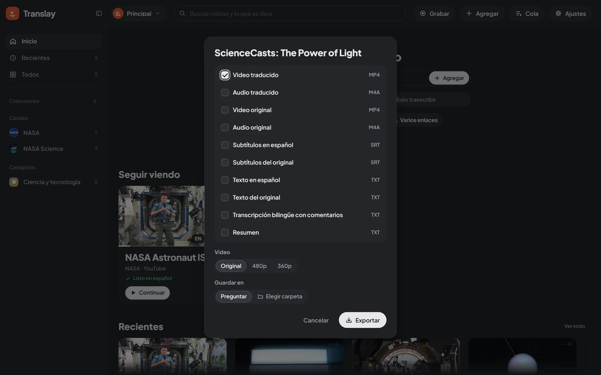

import { Aside } from "@astrojs/starlight/components";

## Qué se puede exportar

En el cuadro de exportar marcas cualquier combinación de:

| Opción | Formato | Contenido |
|---|---|---|
| Video traducido | MP4 | La voz en español como pista principal, el original como segunda pista (marcada con su idioma real, p. ej. `por`) y subtítulos en español y en el idioma original que se activan en el reproductor. |
| Audio traducido | M4A o MP3 | La mezcla en español. |
| Video original | MP4 | El video tal como se descargó o importó. |
| Audio original | M4A o MP3 | La pista de audio original. |
| Subtítulos en español | SRT | La traducción, con sus tiempos. |
| Subtítulos del original | SRT | Lo que se dice, en el idioma del video; el archivo lleva su código (`.en.srt`, `.pt.srt`…). |
| Transcripción bilingüe con comentarios | TXT | Cada frase con su hora, la persona que habla (con su nombre, si se lo pusiste), lo que se dice, su traducción (solo si el video se traduce) y los comentarios. |

La mezcla en español es la misma que escuchas en el reproductor: cada frase doblada en su momento y el original de fondo, al nivel de Preferencias › Audio y subtítulos › «Original bajo la voz en español». Donde nadie habla, el original queda a volumen normal. Se arma con ffmpeg en la CPU, así que no le quita GPU al procesamiento.

Al marcar un audio, «Formato del audio» deja elegir **M4A** (AAC, 160 kbps) o **MP3** (192 kbps, suena en cualquier equipo o radio del auto). El navegador recuerda lo que elegiste. El video traducido siempre lleva AAC dentro del MP4.

## Desde dónde

- **Reproductor**: «Exportar» en la barra del video, para el video abierto.
- **Tarjeta**: el ícono de descarga, o «Exportar…» en su menú contextual.
- **Colección o playlist**: «Exportar» en su cabecera, o «Exportar todo…» en el menú contextual. Si parte de la colección no está descargada, el botón de la cabecera dice «Exportar descargados (N)» y exporta solo lo que ya está en tu equipo, así que nunca va a YouTube; «Exportar todo…» sigue exportando todo.
- **Selección**: «Exportar» con varios videos elegidos.
- **Portada**: «Exportar» junto al video destacado.

## Un archivo o un .zip

Si el resultado es un solo archivo, se descarga tal cual, con el título del video en el nombre. Si son varios (varios videos o varios tipos), van juntos en un `.zip`.

Al exportar varios videos, el `.zip` usa carpetas como los grupos del aside:

- **Desde un canal, colección, playlist o categoría** (su botón de exportar, «Exportar todo…» en su menú o los videos que elegiste dentro), todo va en una carpeta con su nombre: `Anthropic/…`. No hay nada que elegir.
- **Desde Todos, Recientes o una búsqueda**, los videos pueden venir de muchos lados, así que «Carpetas» deja elegir, y el navegador recuerda lo que elegiste:

| Opción | Dentro del `.zip` |
| --- | --- |
| Canales (la de siempre) | Una carpeta por canal: `Anthropic/…`, `Otro canal/…`. Los videos sin canal (archivos, grabaciones) van a `Sin canal`. |
| Colecciones | Una carpeta por cada colección tuya. Un video que está en varias va a la primera; uno que no está en ninguna, a `Sin colección`. |
| Playlists | Una carpeta por playlist importada; el resto va a `Sin playlist`. |
| Sin carpetas | Todos los archivos en la raíz. |

Solo aparecen los grupos a los que pertenecen los videos elegidos (sin playlists, no hay «Playlists»). Las categorías no son una opción: un video suele tener varias, y ningún archivo se repite. La API acepta `"layout": "flat|channel|collection|playlist|folder"` (flat, si no lo indicas) y, con `folder`, el nombre de la carpeta en `"folder"`.

Un lote convierte varios videos a la vez (hasta seis, la mitad de los hilos de tu procesador) y cada archivo entra al `.zip` apenas está listo, así que en el disco queda solo el `.zip` y no además una copia suelta de cada archivo. Si cancelas, se borra lo que se había hecho.

El avance se ve en el panel «Cola», en la sección «Exportar», y la descarga empieza sola al terminar en la pestaña que la pidió. Si la cerraste, el archivo queda en el panel con «Descargar» mientras el servidor siga corriendo. Al arrancar, el servidor borra las exportaciones de más de un día.

## Si el video aún no está listo

El cuadro avisa antes de exportar qué va a tener que esperar:

- **Lo traducido** (video o audio) espera a que el doblaje termine. Si el video no estaba en la cola, entra solo; mientras tanto el panel muestra cuánto lleva el doblaje.
- **Los subtítulos y el TXT** solo esperan la transcripción completa, no el doblaje.
- **Un video sin descargar** se descarga primero.
- **Un video que solo se transcribe** no tiene traducción ni voz: sus opciones traducidas se omiten y, si no marcaste nada más, va a `omitidos.txt`.
- **Un video del que solo se bajó el audio**: si pides un video (original o traducido), se descarga el video completo primero.

Si un video de un lote no se puede exportar (por ejemplo, lo borraron de YouTube y no tiene copia en tu equipo), se omite y el resto sigue: el `.zip` trae `omitidos.txt` con cada video omitido y el motivo, y el panel dice cuántos quedaron fuera. Solo si es un único video, o no se pudo exportar ninguno, la exportación termina en error, con el motivo en palabras claras.

Puedes cancelar una exportación en curso desde el panel de la Cola con «Cancelar».

<Aside>
El código de la exportación está en `vt/exporter.py`. También se puede pedir por la [API](../../integrations/api/).
</Aside>
