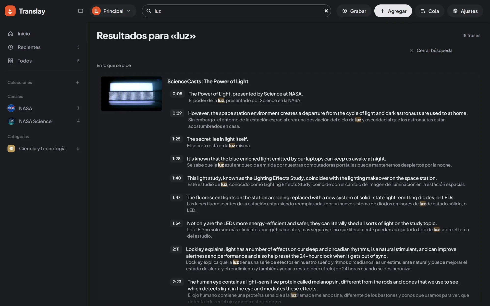

import { Aside } from "@astrojs/starlight/components";

## Glosario

El glosario está en Ajustes › Glosario. Cada fila es un término tal como se dice en el video (en cualquier idioma que Translay traduce) y, a la derecha, cómo se traduce siempre:

| Término | Traducción | Resultado |
|---|---|---|
| `Jupyter Notebook` | (vacío) | Queda como en el original. Sirve para nombres, marcas y siglas. |
| `prompt` | `instrucción` | Siempre se traduce como «instrucción». |

«Agregar término» suma una fila, «Quitar» la borra y «Guardar glosario» lo aplica. Cada biblioteca tiene su propio glosario.

Los términos se reconocen como palabras completas y sin importar mayúsculas: `prompt` no cambia dentro de «prompts» ni de «prompt-based». Si un término está dentro de otro más largo («Notebook» y «Jupyter Notebook»), se usa el más largo. Antes de traducir, cada término se cambia por un marcador que el traductor deja intacto y después se repone con su traducción fija (`vt/glossary.py`).

### Qué pasa al guardarlo

El glosario se aplica a lo ya traducido, no solo a lo nuevo. Al guardarlo, las frases de la biblioteca que contienen un término agregado, cambiado o quitado se traducen de nuevo, y la voz de esas frases se rehace en la cola. Al terminar, un aviso dice cuántas frases y videos cambiaron.

## Búsqueda

El campo «Buscar videos y lo que se dice» del encabezado busca en la biblioteca abierta. En la biblioteca, la tecla <kbd>/</kbd> lleva directo al campo; desde otra pantalla, al tocarlo vuelves a la biblioteca.

Los resultados llegan en hasta tres grupos:

| Grupo | Qué muestra |
|---|---|
| «Videos» | Los videos cuyo título o canal coincide, como tarjetas normales (hasta 12). |
| «Colecciones y canales» | Las colecciones, playlists, categorías y canales cuyo nombre coincide (hasta 24); un clic la abre. |
| «En lo que se dice» | Las frases que coinciden en lo que se dice, en la traducción y en los [comentarios](../transcript-and-people/#comentarios), agrupadas por video, con el que tiene más coincidencias primero. Cada una muestra la hora de la frase; un clic abre el video justo antes de ese momento. |

El encabezado cuenta lo encontrado, por ejemplo «2 videos · 5 frases · 1 colección». Si nada coincide, dice que ningún video, colección o canal se llama así y que nadie lo dice.

- No importan las tildes ni las mayúsculas: «cancion» encuentra «canción».
- Busca mientras escribes, a partir de dos letras.
- La coincidencia aparece subrayada.

<kbd>Esc</kbd> o «Cerrar búsqueda» vuelve a la colección donde estabas.

<Aside>
Se muestran hasta 20 coincidencias por video y hasta 100 videos; el total de coincidencias aparece arriba de los resultados.
</Aside>
