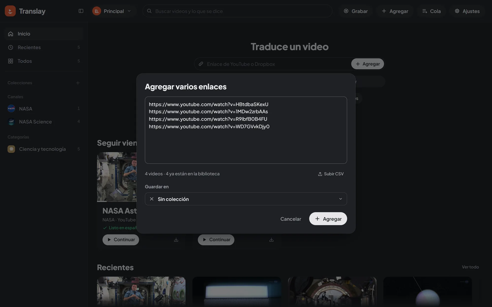

import { Aside } from "@astrojs/starlight/components";

Todo lo que agregas va directo a la cola del servidor: aparece al instante en la biblioteca, atenuado y con su estado, y sigue descargándose y procesándose aunque recargues o cierres la página.

## El botón «Agregar»

El botón «Agregar» del encabezado, con un ícono de más, es un botón dividido:

- **La parte principal** hace lo que más usas en este navegador: «Agregar» (abre el panel con el campo para el enlace), «Subir» (elige videos o audios de tu equipo), «Capturar» (graba la pantalla; solo en los navegadores que lo permiten) o «Pegar enlaces» (abre el cuadro de varios enlaces). Los usos se cuentan solo en este navegador; una acción necesita al menos 3 usos para quedarse con el botón, y con un empate o menos usos queda «Agregar».
- **La parte ▾** siempre abre el panel completo: el campo «Pega un enlace de YouTube o Dropbox» con su botón «Agregar ▾», y tres tarjetas para las demás fuentes: «Archivos», «Grabar pantalla» y «Varios enlaces».

Para dejar el botón siempre en «Agregar», elige Preferencias › Agregar y descargar › «Botón Agregar» › «Siempre «Agregar»»; por defecto es «Lo que más usas».

## Enlaces de YouTube

En el panel, «Agregar» se activa cuando el campo tiene un enlace válido: un video (`watch?v=`, `youtu.be/`, `shorts/`, `live/`), una playlist o un id de 11 caracteres.

También puedes pegar un enlace en cualquier parte de la página, fuera de un campo de texto, o abrir la app con `?yt=<enlace o id>` en la dirección.

Fuera del reproductor, un video agregado no se abre: entra a la cola y aparece en Recientes. Cuando quieras verlo, ábrelo desde su tarjeta.

## Enlaces de Dropbox

Un enlace compartido de Dropbox a un archivo de video o audio se agrega igual que un video de YouTube: entra a la cola, se descarga con su avance en la tarjeta y la tarjeta dice «Dropbox». Sirve con un archivo suelto (`dropbox.com/scl/fi/…/clase.mp4`) y con un archivo dentro de una carpeta compartida (`dropbox.com/scl/fo/…/21_10.mp4`); el enlace a la carpeta entera se rechaza, porque Dropbox entregaría un zip. El enlace tiene que ser público («Cualquier persona con el enlace»).

Translay cambia `dl=0` por `dl=1` para recibir el archivo directo y quita los parámetros de seguimiento (`st`, `e`), así el mismo enlace pegado dos veces es el mismo video. El archivo queda en la carpeta `library/` de la biblioteca, junto a su pista de audio y una miniatura sacada del video. Con «Solo el audio» se baja igual el archivo entero (Dropbox no entrega solo el audio), pero se queda únicamente el audio.

## Idioma y solo transcribir

No hace falta decir en qué idioma está un video: Translay lo detecta con los primeros segundos de voz (inglés, portugués o español; ver [Idiomas](../../how-it-works/languages/)). La flecha junto a «Agregar» en el panel tiene dos opciones para lo que agregas en ese momento (YouTube o Dropbox, uno o varios enlaces):

- «Agregar y traducir»: se traduce y dobla al español. Un video detectado en el idioma de Preferencias › Agregar y descargar › «Solo transcribir lo que está en» (español, si no lo cambias) solo se transcribe.
- «Agregar y solo transcribir»: se transcribe en su idioma y nada más, sea cual sea: sin traducción ni voz, se reproduce con el audio original y un solo subtítulo, la transcripción muestra una columna y la tarjeta dice «Transcrito» al terminar.

Un idioma que Translay todavía no traduce solo se transcribe, en ese idioma.

Para cambiarlo después, usa «Idioma y traducción» en el menú contextual del video. «Se habla en» corrige el idioma: lo transcrito en el otro se borra y el video se vuelve a procesar, por eso pregunta antes. «Traducir y doblar» y «Solo transcribir» cambian el modo sin borrar nada: lo reconocido sirve para los dos y las traducciones quedan guardadas.

<Aside>
Los perfiles ligeros («Ligero» y «Subtítulos ligeros») usan Whisper `small`, que reconoce todos los idiomas pero se equivoca más en portugués que en inglés (ver [Rendimiento](../performance/)). Un modelo `.en` elegido con `--model` solo reconoce inglés: un video en otro idioma termina en un error que pide cambiar de perfil.
</Aside>

## Varios enlaces

Si pegas texto con más de un enlace (o usas «Varios enlaces» en el panel), se abre el cuadro «Agregar varios enlaces» para revisarlos antes; su botón «Agregar» los agrega. Toma los enlaces de YouTube y de Dropbox de cualquier parte del texto (uno por línea, separados por comas o mezclados con otro texto) y muestra un resumen: cuántos videos, cuántas playlists y cuántos ya están en la biblioteca. Los repetidos cuentan una sola vez.

En «Guardar en» eliges una colección propia o una categoría para lo que agregues; las categorías de YouTube aparecen todas aunque aún no tengas videos en ellas.

Con miles de enlaces, los videos aparecen enseguida con su id y los títulos se completan de a poco, con pocas consultas a la vez para no parecer una ráfaga a YouTube.

## Playlists

Un enlace de playlist (`list=…`) se agrega como colección, marcada «Playlist», y todos sus videos entran a la cola en orden. Volver a pegarla la actualiza.

Si el enlace es de un video dentro de una playlist, Translay pregunta «Este enlace es de una playlist» con dos opciones: «Solo este video» o «Agregar playlist». Mientras ves un video no pregunta: se agrega solo ese video.

Los mix automáticos de YouTube (listas que empiezan con `RD` o `UL`) no tienen fin, así que se tratan como un video suelto.

## Desde un CSV

«Archivos» del panel acepta un `.csv`, y también puedes arrastrarlo a la página o usar «Subir CSV» dentro del cuadro de varios enlaces. Translay toma:

- Los enlaces de YouTube y de Dropbox de cualquier columna.
- Los ids sueltos de 11 caracteres de una columna llamada `id`, `video_id`, `youtube_id` o `yt_id`.

El separador puede ser coma, punto y coma o tabulación. Los enlaces encontrados se abren en el cuadro de varios enlaces para revisarlos antes de agregarlos.

## Archivos de tu equipo

«Archivos» del panel (o «Subir» cuando el botón lo muestra, o arrastrar a la página) acepta videos y audios. Cada archivo se copia a la carpeta `library/` de la biblioteca abierta, con una miniatura sacada del video, y entra a la cola. Lo reconoce por una huella de su contenido, así que renombrarlo no lo duplica.

## Grabar la pantalla

«Grabar pantalla», en el panel «Agregar» (o «Capturar» cuando el botón lo muestra), graba una pestaña del navegador, una ventana o toda la pantalla y la agrega a la biblioteca como cualquier video. Necesita un navegador de computadora (Chrome o Edge) y la página abierta en este equipo o por `https`.

1. El navegador pregunta qué compartir. Para tener algo que traducir, la fuente debe traer sonido: una pestaña, o la pantalla completa con «Compartir audio» activado. Una ventana sola normalmente no trae sonido en Windows; en ese caso el cuadro lo dice y «Elegir otra» vuelve a abrir el selector.
2. En la vista previa, al mover el cursor se resaltan los recuadros que encuentra: donde la imagen se mueve sin parar (un video, aunque ocupe solo parte de una página) y las cajas de bordes rectos (ventanas, paneles, reproductores). Un clic elige el recuadro resaltado, la rueda del mouse pasa al recuadro que lo contiene y arrastrar marca una zona a mano. «Toda la imagen» vuelve a grabar todo.
3. Elige la calidad; debajo se ve el tamaño del archivo final y cuánto pesará como máximo por minuto y por hora:

| Calidad | Alto máximo | Tope de video a 30 cuadros |
|---|---|---|
| Alta | 1080p | 4 Mbit/s |
| Media (predeterminada) | 720p | 2 Mbit/s |
| Ligera | 480p | 0,9 Mbit/s |
| Solo audio | — | M4A a 96 kbit/s |

A 15 cuadros por segundo el tope es dos tercios; una zona más chica pesa proporcionalmente menos. Es un techo: una pantalla con poco movimiento suele pesar bastante menos.

4. «Grabar». Una barra abajo muestra el tiempo, el peso estimado y la última frase traducida: la grabación se transcribe y traduce en vivo. «Detener», o «Dejar de compartir» del navegador, la termina.

Al detenerla, el servidor arma el archivo (recortado a la zona y comprimido a H.264 + AAC) y entra a la cola, que completa el doblaje.

<Aside title="Nada se pierde si se corta la conexión">
Cada segundo de grabación se guarda en el navegador antes de subirse y se borra solo cuando el servidor lo confirma. Sin conexión se sigue grabando («Sin conexión: se guarda en este equipo») y la subida se retoma al volver; la transcripción en vivo se reconecta sola y reenvía lo que no había confirmado. Si cierras la pestaña o se apaga el equipo, la próxima vez que abras Translay termina de subir lo grabado y lo arma.
</Aside>

## Agregar dentro de una colección

En una colección propia o una categoría, el botón «Agregar» de su cabecera (o «Agregar aquí…» en el menú contextual) abre el cuadro de varios enlaces con esa colección ya elegida en «Guardar en». Si la colección está vacía, el botón aparece en el centro.

Un video agregado en una categoría aparece en ella aunque YouTube lo tenga en otra.

## Solo descargar o traducir

Preferencias › Agregar y descargar › «Al agregar» decide qué se hace con lo nuevo:

- **Descargar y traducir** (por defecto): se descarga, se traduce y se dobla.
- **Solo descargar**: se descarga sin usar la GPU y queda «Descargado, sin traducir». Sirve para ver o exportar el original. Cuando quieras traducirlo, usa «Procesar» en su tarjeta o en la Cola; abrirlo para verlo también lo procesa.

En un video de YouTube o de Dropbox aún sin descargar, «Ver ▾» › «Descargar sin abrir» lo baja con prioridad sin abrirlo ni traducirlo.

## Solo el audio

Preferencias › Agregar y descargar › «Qué descargar» › «Solo el audio (más rápido)» baja solo la pista de audio. Se traduce y se dobla igual; el reproductor muestra la miniatura en lugar de la imagen y la tarjeta lleva la etiqueta «Solo audio».

Para tener la imagen después, usa «Bajar video» en la tarjeta (o en la selección): se descarga el video completo sin volver a traducir. Si exportas un video, original o traducido, el video completo se descarga primero.

Estas dos preferencias son propias de cada [biblioteca](../libraries/).

## Mientras ves un video

El botón «Agregar» sigue disponible en el reproductor. Qué pasa con lo que agregas lo decide Preferencias › Reproducción › «Al agregar un video mientras ves otro»:

| Opción | Qué hace |
|---|---|
| Ponerlo a continuación (por defecto) | Entra a la cola y queda justo después del actual en «Siguientes». |
| Procesarlo en segundo plano | Solo entra a la cola. |
| Abrirlo | Se descarga con prioridad y se abre en cuanto termina. Con archivos del equipo, se abre el primero y los demás quedan en «Siguientes». |

<Aside>
Los videos que ya están en otra biblioteca no se duplican: se quedan allá y un aviso lo indica. Ver [Bibliotecas](../libraries/#mover-videos).
</Aside>
