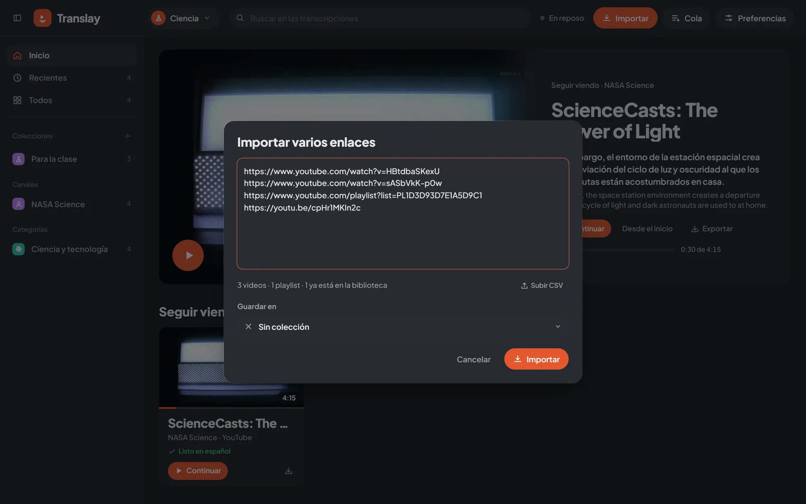

import { Aside } from "@astrojs/starlight/components";

Todo lo que importas va directo a la cola del servidor: aparece al instante en la biblioteca, atenuado y con su estado, y sigue descargándose y procesándose aunque recargues o cierres la página.

## Enlaces de YouTube

El botón «Importar» del encabezado abre un campo para pegar enlaces y el botón «Archivos». «Importar» se activa cuando el campo tiene un enlace válido: un video (`watch?v=`, `youtu.be/`, `shorts/`, `live/`), una playlist o un id de 11 caracteres.

También puedes pegar un enlace en cualquier parte de la página, fuera de un campo de texto, o abrir la app con `?yt=<enlace o id>` en la dirección.

Fuera del reproductor, un video importado no se abre: entra a la cola y aparece en Recientes. Cuando quieras verlo, ábrelo desde su tarjeta.

## Enlaces de Dropbox

Un enlace compartido de Dropbox a un archivo de video o audio se importa igual que un video de YouTube: entra a la cola, se descarga con su avance en la tarjeta y la tarjeta dice «Dropbox». Sirve con un archivo suelto (`dropbox.com/scl/fi/…/clase.mp4`) y con un archivo dentro de una carpeta compartida (`dropbox.com/scl/fo/…/21_10.mp4`); el enlace a la carpeta entera se rechaza, porque Dropbox entregaría un zip. El enlace tiene que ser público («Cualquier persona con el enlace»).

Translay cambia `dl=0` por `dl=1` para recibir el archivo directo y quita los parámetros de seguimiento (`st`, `e`), así el mismo enlace pegado dos veces es el mismo video. El archivo queda en la carpeta `library/` de la biblioteca, junto a su pista de audio y una miniatura sacada del video. Con «Solo el audio» se baja igual el archivo entero (Dropbox no entrega solo el audio), pero se queda únicamente el audio.

## Videos que ya están en español

Si el video ya está en español, abre la flecha junto a «Importar» y elige «Está en español: solo transcribir». Vale para lo que importas en ese momento (YouTube o Dropbox, uno o varios enlaces). El video se transcribe en español y nada más: sin traducción ni voz en español, se reproduce con el audio original y un solo subtítulo, la transcripción muestra una columna y la tarjeta dice «Transcrito» al terminar.

Para cambiarlo después, usa «Idioma del video» en el menú contextual del video: «Inglés: traducir y doblar» o «Español: solo transcribir». Lo que ya estaba transcrito en el otro idioma se borra y el video se vuelve a procesar, por eso pregunta antes.

<Aside>
Los perfiles ligeros («Ligero» y «Subtítulos ligeros») usan Whisper `small`, que también reconoce español. Un modelo `.en` elegido con `--model` solo reconoce inglés: un video en español termina en un error que pide cambiar de perfil.
</Aside>

## Varios enlaces

Si pegas texto con más de un enlace, se abre el cuadro «Importar varios enlaces» para revisarlos antes. Toma los enlaces de YouTube y de Dropbox de cualquier parte del texto (uno por línea, separados por comas o mezclados con otro texto) y muestra un resumen: cuántos videos, cuántas playlists y cuántos ya están en la biblioteca. Los repetidos cuentan una sola vez.

En «Guardar en» eliges una colección propia o una categoría para lo que importes; las categorías de YouTube aparecen todas aunque aún no tengas videos en ellas.

Con miles de enlaces, los videos aparecen enseguida con su id y los títulos se completan de a poco, con pocas consultas a la vez para no parecer una ráfaga a YouTube.

## Playlists

Un enlace de playlist (`list=…`) se importa como colección, marcada «Playlist», y todos sus videos entran a la cola en orden. Volver a pegarla la actualiza.

Si el enlace es de un video dentro de una playlist, Translay pregunta «Este enlace es de una playlist» con dos opciones: «Solo este video» o «Agregar playlist». Mientras ves un video no pregunta: se importa solo ese video.

Los mix automáticos de YouTube (listas que empiezan con `RD` o `UL`) no tienen fin, así que se tratan como un video suelto.

## Desde un CSV

«Archivos» acepta un `.csv`, y también puedes arrastrarlo a la página o usar «Subir CSV» dentro del cuadro de varios enlaces. Translay toma:

- Los enlaces de YouTube y de Dropbox de cualquier columna.
- Los ids sueltos de 11 caracteres de una columna llamada `id`, `video_id`, `youtube_id` o `yt_id`.

El separador puede ser coma, punto y coma o tabulación. Los enlaces encontrados se abren en el cuadro de varios enlaces para revisarlos antes de importar.

## Archivos de tu equipo

«Archivos» (o arrastrar a la página) acepta videos y audios. Cada archivo se copia a la carpeta `library/` de la biblioteca abierta, con una miniatura sacada del video, y entra a la cola. Lo reconoce por una huella de su contenido, así que renombrarlo no lo duplica.

## Importar dentro de una colección

En una colección propia o una categoría, el botón «Importar» de su cabecera (o «Importar aquí…» en el menú contextual) abre el cuadro de varios enlaces con esa colección ya elegida en «Guardar en». Si la colección está vacía, el botón aparece en el centro.

Un video importado en una categoría aparece en ella aunque YouTube lo tenga en otra.

## Solo descargar o traducir

Preferencias › Importar y descargas › «Al importar» decide qué se hace con lo nuevo:

- **Descargar y traducir** (por defecto): se descarga, se traduce y se dobla.
- **Solo descargar**: se descarga sin usar la GPU y queda «Descargado, sin traducir». Sirve para ver o exportar el original. Cuando quieras traducirlo, usa «Procesar» en su tarjeta o en la Cola; abrirlo para verlo también lo procesa.

En un video de YouTube o de Dropbox aún sin descargar, «Ver ▾» › «Descargar sin abrir» lo baja con prioridad sin abrirlo ni traducirlo.

## Solo el audio

Preferencias › Importar y descargas › «Qué descargar» › «Solo el audio (más rápido)» baja solo la pista de audio. Se traduce y se dobla igual; el reproductor muestra la miniatura en lugar de la imagen y la tarjeta lleva la etiqueta «Solo audio».

Para tener la imagen después, usa «Bajar video» en la tarjeta (o en la selección): se descarga el video completo sin volver a traducir. Si exportas un video, original o traducido, el video completo se descarga primero.

Estas dos preferencias son propias de cada [biblioteca](../libraries/).

## Mientras ves un video

El botón «Importar» sigue disponible en el reproductor. Qué pasa con lo que importas lo decide Preferencias › Reproducción › «Al agregar un video mientras ves otro»:

| Opción | Qué hace |
|---|---|
| Ponerlo a continuación (por defecto) | Entra a la cola y queda justo después del actual en «Siguientes». |
| Procesarlo en segundo plano | Solo entra a la cola. |
| Abrirlo | Se descarga con prioridad y se abre en cuanto termina. Con archivos del equipo, se abre el primero y los demás quedan en «Siguientes». |

<Aside>
Los videos que ya están en otra biblioteca no se duplican: se quedan allá y un aviso lo indica. Ver [Bibliotecas](../libraries/#mover-videos).
</Aside>
