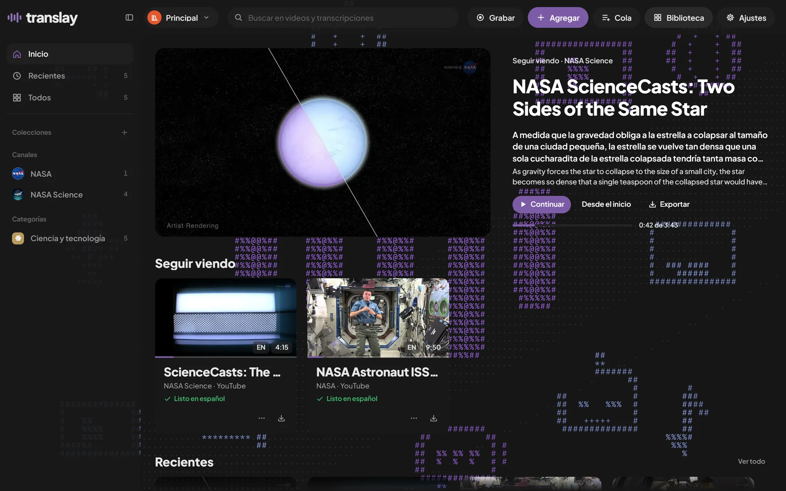
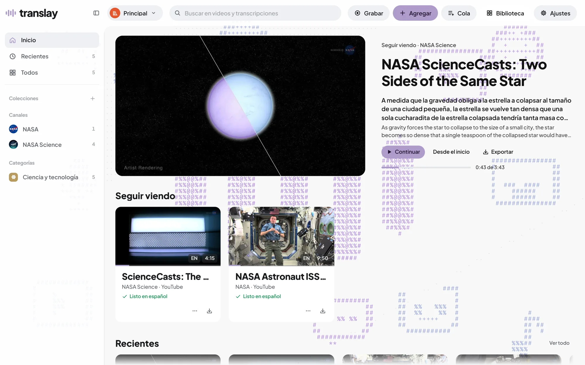
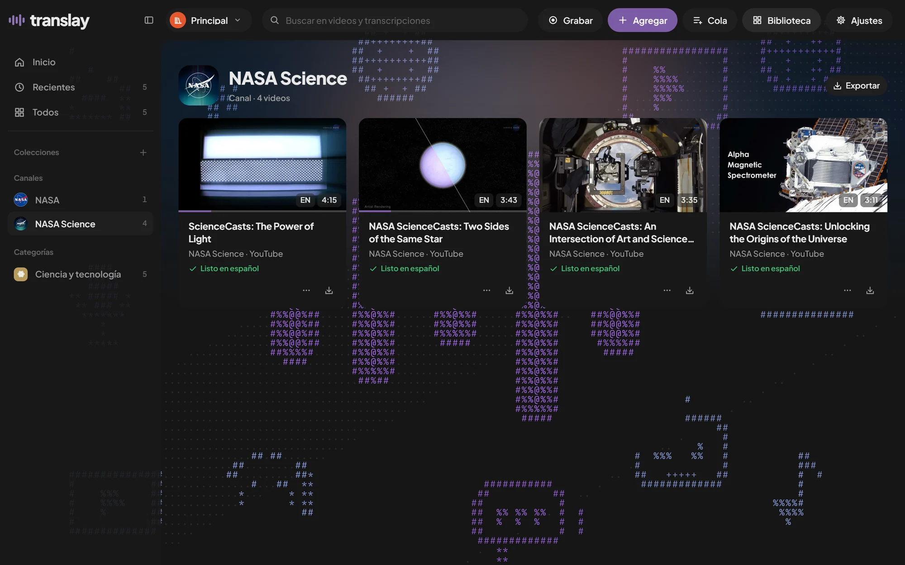

import { Aside } from "@astrojs/starlight/components";
import { Image } from "astro:assets";
import movil from "../../../../assets/capturas/movil-inicio.webp";

La biblioteca es la pantalla con la que abre Translay. A la izquierda está la barra lateral con las colecciones; a la derecha, la portada o la colección elegida.

## Portada

**Inicio** empieza con lo que estás viendo: su miniatura, el título, la frase donde ibas en los dos idiomas, **Continuar**, **Desde el inicio** y **Exportar**, con la luz de su miniatura detrás (o el último video agregado, si aún no empezaste ninguno). En pantallas grandes crece con la ventana y muestra también las ideas clave y los primeros capítulos de su resumen; un capítulo empieza el video en ese momento. Agregar y grabar están en la barra de arriba, en todas las pantallas.

El fondo se elige en Ajustes › Apariencia › **Fondo**, con el inicio de verdad como vista previa al lado de las opciones: una escena animada hecha solo de caracteres, **Translay** (la onda de voz del logo hablando en el centro y, flotando alrededor, una nota musical, un video, una clase, el agente, un micrófono, subtítulos, idiomas y una conversación; por defecto), **Fondo marino** (con peces), **Atardecer**, **Medusas** **Arañas** (con telarañas y rocío) o **Arañas, Shade y Manchita** (lo mismo, con Shade, un perrito que pasa caminando, se detiene a inclinar la cabeza cuando suena un juguete y sigue, mientras Manchita, una gatita con una manchita en la nariz, mira, parpadea y mueve las orejas), o **Imagen propia** (una imagen tuya, oscurecida; se reduce en el navegador y se guarda en `data/ui/home-bg.jpg`). La escena va detrás de todas las pantallas (fuera del inicio, más tenue para no competir con el texto), toma el color de énfasis del tema (pasteles suaves en claro, más intensos en oscuro) y queda quieta si el sistema pide reducir el movimiento. El texto del destacado pasa a claro u oscuro según lo que tenga detrás, así siempre se lee.

Al dejar el mouse medio segundo sobre la miniatura de un video descargado, se reproduce sin sonido desde donde ibas (o desde el 10 %), como en YouTube; se detiene al salir.

Debajo van las filas, cada una con su «Ver todo» cuando tiene más de cuatro videos:

- **Seguir viendo**: los demás videos empezados y sin terminar, del último abierto al primero.
- **Recientes**.
- Hasta ocho de tus colecciones y playlists.
- Los cuatro canales con más videos y las dos categorías con más videos (solo las que tienen más de uno).

Con la biblioteca vacía, el inicio lo dice y ofrece **Agregar video**, lo mismo que el botón de la barra de arriba.

  <Image src={movil} alt="La portada en un celular, con las colecciones como pestañas" width={390} />
  
En el celular, las colecciones pasan a una fila de pestañas arriba y la portada ocupa todo el ancho. En modo claro se ve así:

## Colecciones automáticas

Se arman solas a partir de los videos; no se pueden renombrar ni eliminar.

| Colección | Qué muestra |
|---|---|
| Recientes | Los videos que ya están en el equipo y lo recién importado (aunque aún se esté descargando), del último abierto o agregado al primero. Lo pendiente de una playlist aparece solo en su playlist. |
| Todos | Cada video de la biblioteca, también lo que falta descargar, del último agregado al primero. |
| Canales | Una por canal de YouTube, con el avatar y el banner reales del canal. Se pueden ocultar en Ajustes › Agregar y descargar › «Canales en la barra lateral». |
| Categorías | Una por categoría de YouTube, con su nombre en español (Educación, Ciencia y tecnología, Música…). |

Las categorías y los canales se calculan con los videos de Recientes. La lista completa de categorías está en `vt/library.py`.

## Colecciones propias

Se crean con el **+** junto al título «Colecciones» de la barra lateral, con «Nueva colección…» del menú contextual, o desde el reproductor con «Guardar en…». Cuando abres por primera vez un video que no está en la biblioteca ni en una playlist, el panel «Guardar en…» se abre solo para que elijas dónde guardarlo.

Un video puede estar en varias colecciones. Para sacarlo de una, usa la **×** de su tarjeta («Quitar de la colección») o el menú contextual. Eliminar una colección no borra sus videos.

## Playlists

Una playlist de YouTube importada se guarda como colección, con el número de orden en cada tarjeta y los botones «Reproducir» y «Abrir en YouTube». Sus videos entran a la cola y se descargan y procesan en orden. Volver a importar la misma playlist la actualiza con su orden actual.

Al eliminar una playlist, los videos descargados se quedan en la biblioteca; los que faltaba descargar salen de la cola y de la biblioteca. Cómo agregarlas: [Agregar videos](../import/#playlists).

## Tarjetas

Cada tarjeta muestra la miniatura, el idioma en que se habla en el video (EN, PT, ES…, junto a la duración), la duración, el canal y lo que falta: «En cola · sin descargar», «Descargando 40 % · 2,3 MB/s · quedan 0:12», «Procesando · 42 %», «Descargado, sin traducir» y «Listo en español», o «Descargado, sin transcribir» y «Transcrito» si [solo se transcribe](../import/#idioma-y-solo-transcribir). El anillo sobre la miniatura muestra cuánto está traducido y cuánto doblado; la barra fina de abajo, hasta dónde lo viste.

Un clic en cualquier parte de la tarjeta abre el video (ya no hay botones «Ver» ni «Continuar»). El botón **⋯** abre el mismo menú que el clic derecho. Los botones de la tarjeta cambian según su estado:

| Botón | Cuándo aparece |
|---|---|
| «Procesar» | Si no está traducido y no está en la cola. |
| «Descargar video» | Si solo se descargó el audio. |
| Exportar | Siempre (el ícono de descarga). Ver [Exportar](../export/). |

La biblioteca dibuja las tarjetas de a 200; «Mostrar más» agrega las siguientes.

## Encabezados y su luz

Una colección, playlist, canal o categoría abre con su distintivo (el avatar del canal, o su ícono sobre su color), su nombre, cuántos videos tiene y sus acciones. Detrás hay una luz suave, como el modo ambiente de YouTube: el banner de YouTube del canal, o las miniaturas de sus videos, difuminados y tenues; sin imágenes, la luz de su color. El color de cada colección sale de su nombre, así que siempre es el mismo; «Otro color», en el menú contextual, lo cambia, y la elección se guarda en el navegador.

## Selección múltiple

Cada tarjeta tiene una casilla. En una colección que mezcla videos descargados con otros que siguen en la cola, «Seleccionar descargados (N)» en la cabecera elige solo los que ya están en tu equipo (con su audio o video), por ejemplo para exportar su audio. Con al menos un video elegido, la cabecera cambia a «N seleccionados» con estas acciones (también en el inicio, y en el celular quedan bajo el encabezado aunque bajes mucho):

- «Abrir»: los reproduce en orden; quedan en la pestaña «Siguientes».
- «Procesar»: los manda a la cola para traducirlos y doblarlos.
- «Exportar».
- «Descargar video (N)»: de los elegidos que solo tienen el audio.
- «Mover a…»: a otra biblioteca (aparece si tienes más de una).
- «Eliminar» y «Quitar selección».

## Renombrar

«Renombrar…» en el menú contextual de una tarjeta o del video que estás viendo le pone a un video tu propio nombre, por ejemplo para que un archivo llamado `21_10` pase a ser «Clase de estadística». El nombre cambia al instante en todos lados y se queda: volver a descargar el video, abrirlo o leer su título de YouTube no lo pisa.

## Eliminar

«Eliminar» (en la selección o «Eliminar video» en el menú contextual) mueve el video a la [papelera](../trash/) con su traducción, sus voces y lo descargado: el aviso trae **Deshacer** y se puede restaurar durante 30 días. Vaciar toda la biblioteca está en el menú «⋯» de la biblioteca y pide escribir su nombre.

## Menú contextual

El clic derecho abre un menú que depende de dónde hagas clic:

| Dónde | Qué ofrece |
|---|---|
| Tarjeta de video | Ver o Continuar, Ver desde el inicio, Traducir y doblar (o Transcribir), Idioma y traducción, Renombrar…, Guardar en, Mover a, Exportar…, Abrir en YouTube, Copiar enlace, Seleccionar, Eliminar video. |
| Colección (barra lateral, fila de la portada o banner) | Abrir, Reproducir, Agregar aquí…, Exportar todo…, Otro patrón, Renombrar…, Eliminar. |
| Trabajo de la cola | Abrir el video, Detener o Continuar, Priorizar, Traducir y doblar, Detener toda la cola, Copiar enlace, Quitar de la cola. |
| Frase de la transcripción | Ir a este momento, Copiar en español y en el idioma del original (o solo Copiar si solo se transcribe), Copiar enlace a este momento, Comentar. |
| Video | Reproducir o Pausar, Escuchar el original o en español (si se traduce), Pantalla completa, Mostrar u Ocultar el panel, Renombrar…, Guardar en…, Exportar…, Copiar enlace a este momento. |
| Espacio libre | Agregar enlaces…, Agregar archivos…, Nueva colección…, Inicio, Cola, Ajustes, contraer la barra lateral, Recargar. |

Sobre la casilla de una tarjeta es el menú del video. En campos de texto, sobre un enlace o con texto seleccionado queda el menú del navegador. El código está en `web/js/contextmenu.js`.

## Barra lateral

Arriba quedan fijos Inicio, Recientes y Todos; debajo, con su propio desplazamiento, Colecciones, Playlists, Canales y Categorías, cada una con su cantidad de videos. El botón junto al logo la contrae a una columna de íconos (en el reproductor, ese mismo botón muestra u oculta la transcripción). La elección se recuerda en el navegador.

## La dirección guarda dónde estás

La dirección de la página cambia con cada pantalla, así que recargar te deja en el mismo lugar y los botones atrás y adelante del navegador funcionan:

| Dirección | Pantalla |
|---|---|
| `#/` | Inicio |
| `#/c/<colección>` | Una colección, playlist, canal o categoría |
| `#/video/<id>` | El reproductor con ese video |
| `#/cola` | La pantalla de la Cola |
| `#/preferencias/<sección>` | Una sección de Ajustes |

Mientras llegan los datos al recargar se ve la silueta de la página. El código está en `web/js/route.js`.

<Aside>
Quien entra desde otro equipo como invitado no ve las acciones que no tiene permitidas (eliminar, crear colecciones, importar). Ver [Acceso](../../integrations/access/).
</Aside>
