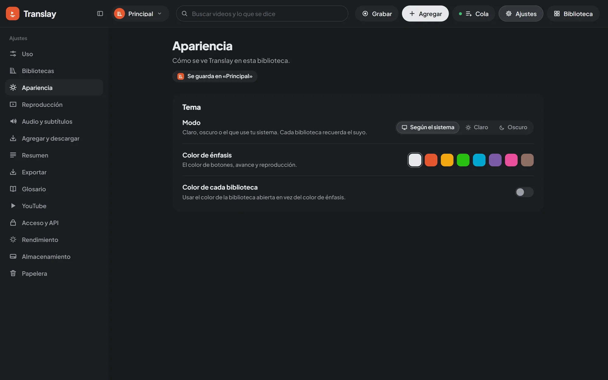

import { Aside } from "@astrojs/starlight/components";

«Preferencias», en el encabezado, abre una pantalla propia: las secciones a la izquierda y, a la derecha, la página de la sección elegida, con sus opciones agrupadas y una descripción de cada una. Las de sí o no son interruptores; las demás, botones para elegir una opción. Los cambios se aplican al instante, sin botón de guardar. Al tocar «Preferencias» de nuevo vuelves al video o a la biblioteca.

Se guardan en el servidor (`data/prefs.json`) y valen para todas las pestañas y equipos. Algunas son propias de cada biblioteca y se guardan en ella (ver [Bibliotecas](../libraries/#qué-guarda-cada-una)). Solo el dueño puede cambiarlas.

La tabla completa, con cada opción y su valor por defecto, está en la [referencia de preferencias](../../reference/preferences/).

## Bibliotecas

Tus bibliotecas como tarjetas, con su carpeta: abrirlas, editarlas, cambiarles el patrón, quitarlas de la lista o eliminarlas. «Abrir carpeta» agrega una carpeta que ya es biblioteca. Todo esto se explica en [Bibliotecas](../libraries/).

## Apariencia

El **Modo**: claro, oscuro o el que use tu sistema. Es propio de cada biblioteca, así que puedes tener una clara y otra oscura. **Color de énfasis** es el color de los botones, el avance y la reproducción: el del tema o uno de siete. Con **Color de cada biblioteca**, toman en su lugar el color de la biblioteca abierta.

## Reproducción

Qué pasa al abrir y al terminar un video: si empieza solo cuando está listo, si sigue con el próximo de «Siguientes» y si se pausa al llegar a una parte que aún no tiene voz en español. También la vista por defecto (ampliada o dividida), cuándo se muestra el indicador «Listo para reproducir» y qué hacer con un enlace que agregas mientras ves otro video. Cómo se comporta cada una: [Reproductor](../player/#reproducción-automática) y [Agregar videos](../import/#mientras-ves-un-video).

## Audio y subtítulos

Con qué audio empieza cada video (en español u original; luego se cambia sobre el video), qué tan fuerte queda el original debajo de la voz en español (silencio, bajo o medio) y qué subtítulos se muestran: el español abajo, el del original arriba («Subtítulos del original»), o ninguno. El nivel del original también se usa al [exportar](../export/).

## Agregar y descargar

Qué se hace con lo que agregas (descargar y traducir, o solo descargar), qué hace el botón «Agregar» del encabezado («Botón Agregar»: «Lo que más usas» o «Siempre «Agregar»»), qué idioma solo se transcribe al detectarlo («Solo transcribir lo que está en»: español, si no lo cambias, inglés, portugués o ninguno), qué se descarga (video y audio, o solo el audio), en qué orden se bajan las descargas (el de la cola o aleatorio), los avisos del navegador y si los canales aparecen en la barra lateral de la biblioteca. «Al agregar» y «Qué descargar» son propias de cada biblioteca. Detalle en [Agregar videos](../import/#solo-descargar-o-traducir), [Agregar videos › El botón «Agregar»](../import/#el-botón-agregar), [Agregar videos › Idioma](../import/#idioma-y-solo-transcribir) y [Cola](../queue/#descargas).

## Resumen

**Resumen**. Cuándo se resume cada video (**Resumir**: **Al pedirlo**, por defecto, con el botón de la pestaña «Resumen», o **Al procesar cada video**, apenas la cola lo termina) y con qué modelo (**Modelo**: **Automático**, que dice cuál usa en tu equipo, o Qwen3 4B, 1.7B o 0.6B). Los más grandes resumen con más detalle; los livianos son más rápidos y funcionan sin GPU. Ver [Transcripción › Resumen](../transcript-and-people/#resumen).

## Exportar

**Exportar**, solo en el equipo donde corre Translay. **Al exportar**: **Preguntar** (por defecto) abre el cuadro de Windows en la última carpeta que usaste; con una carpeta fija, todo se guarda ahí sin preguntar. Desde otros equipos lo descarga el navegador. Ver [Exportar › Dónde se guarda](../export/#dónde-se-guarda).

## Glosario

Términos que no se traducen o que siempre se traducen igual, propios de la biblioteca abierta. Ver [Glosario y búsqueda](../glossary-and-search/).

## YouTube

La sesión que se usa para descargar (ninguna, la cuenta conectada, la de un navegador o un archivo `cookies.txt`), el botón para conectar tu cuenta de YouTube y los botones para importar una sesión. Ver [YouTube](../youtube/#sesión-de-youtube).

## Acceso y API

Quién entra desde otros equipos: la contraseña del dueño, el acceso desde la red local, el acceso de cada biblioteca (privada, con contraseña o pública), las claves de API y los webhooks. Ver [Acceso](../../integrations/access/), [API](../../integrations/api/) y [Webhooks](../../integrations/webhooks/).

## Rendimiento

Tu equipo, el perfil de modelos (automático o el que elijas), los límites de VRAM, RAM y CPU, cuánto tarda un video y los avisos de por qué algo va lento. Ver [Rendimiento](../performance/).

## Almacenamiento

Cuánto ocupa cada cosa y qué puedes liberar: las descargas que nunca se tradujeron, las más pesadas una por una, los modelos que no usas, la papelera, los archivos sueltos y la caché de instalación. Ver [Almacenamiento](../storage/).

## Papelera

Lo borrado en los últimos 30 días, para restaurarlo o borrarlo para siempre. Ver [Papelera](../trash/).

<Aside>
Cada sección tiene su propia dirección (`#/preferencias/<sección>`), así que recargar la página te deja en la misma. Las preferencias se definen en `vt/prefs.py`.
</Aside>

## App de escritorio

Solo en la app para Windows: qué hace la ventana al cerrarla (salir o seguir en la bandeja), la carpeta de la biblioteca Principal y los registros. Ver [App de escritorio](../desktop-app/).
