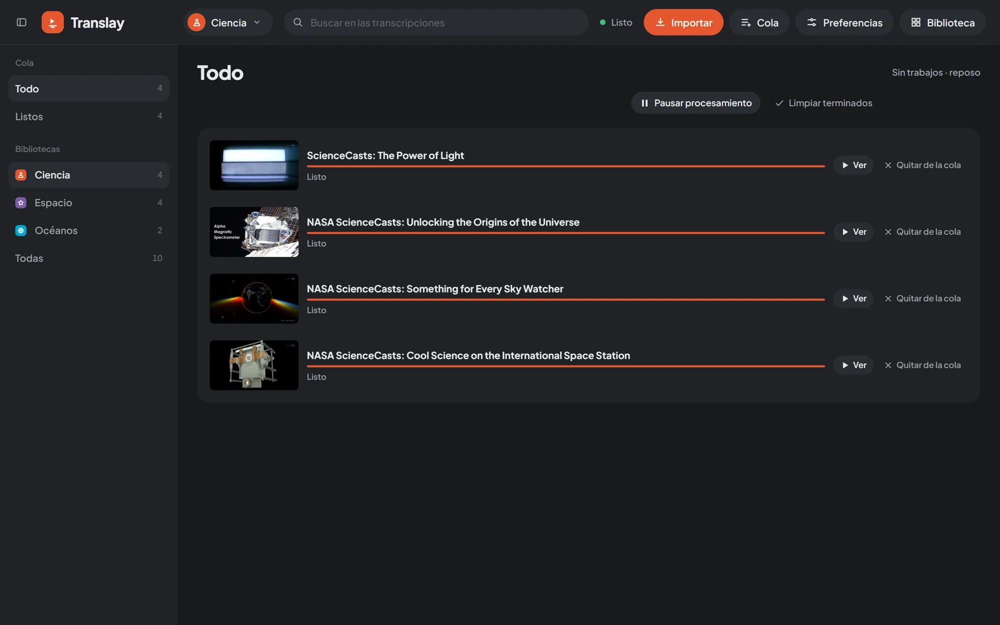

import { Aside } from "@astrojs/starlight/components";

Todo se procesa en una sola cola, en el servidor (`vt/processor.py`). Sigue trabajando aunque cierres la pestaña o recargues, y se retoma donde quedó si reinicias el servidor. Se guarda en `data/queue.json`.

## Orden y prioridades

1. **El video que estás viendo** va siempre primero. Se procesa desde tu punto de reproducción hacia el final y después lo que quedó antes; si saltas a una parte sin terminar, el procesamiento salta contigo. Al volver a la biblioteca sigue en la cola como cualquier otro.
2. **Lo priorizado**: «Priorizar», en la tarjeta o en la Cola, pone un video primero. Si ya está descargado, deja atrás al trabajo de fondo en curso, que se retoma después sin perder lo avanzado.
3. **El resto**, en el orden en que entró.

Si un tramo ya reconocido quedó sin traducción o sin voz (por un procesamiento que se cortó), la cola lo completa al pasar por ahí.

## Pausar

«Pausar» detiene el procesamiento de fondo; el video que estás viendo se sigue procesando igual. Las descargas no usan la GPU y siguen aunque la cola esté en pausa. Si pausas sin ningún video abierto, los modelos salen de la GPU de inmediato.

## Panel y pantalla de la Cola

El botón «Cola» del encabezado lleva un número con lo pendiente de la biblioteca abierta. Al tocarlo se abre un panel con el estado general, «Pausar» o «Reanudar», las exportaciones, las descargas en curso y los primeros 50 trabajos. «Ver todo» abre la pantalla completa.

La pantalla de la Cola tiene los estados a la izquierda, con su cantidad, y la lista a la derecha, de a 100:

| Estado | Qué hay |
|---|---|
| Todo | Todos los trabajos, con lo que se descarga primero. |
| Descargando | Lo que se está bajando, con porcentaje, velocidad y tiempo restante. |
| Procesando | El trabajo en curso («Viendo · N %» si es el video abierto). |
| En cola | Lo que espera su turno. |
| Descargados sin traducir | Lo importado con «Solo descargar». Tienen «Procesar». |
| Con error | Lo que falló, con el motivo. |
| Listos | Lo terminado. |

Si tienes más de una [biblioteca](../libraries/#cola-y-bibliotecas), debajo puedes elegir de cuál ver los trabajos, o «Todas». Si hay exportaciones, aparecen en su propia sección.

En la cabecera están «Pausar procesamiento» o «Reanudar procesamiento», «Reintentar descargas» (solo con las descargas en pausa) y «Limpiar terminados», que quita de la lista lo listo, lo descargado sin traducir y lo que tuvo error. Cada trabajo tiene «Ver», «Quitar de la cola» y, según su estado, «Priorizar» o «Procesar».

## Descargas

Las descargas van en un hilo aparte, una a la vez y con una pausa breve al azar entre una y otra, para no parecer una ráfaga a YouTube. Para no llenar el disco, solo se descargan unos pocos videos por delante de lo que ya se procesó; lo priorizado, lo que pides abrir y lo importado con «Solo descargar» no esperan ese turno.

Con Preferencias › Importar y descargas › «Orden de las descargas» › «Aleatorio (variado)» se descarga de cualquier parte de la cola; lo priorizado sigue yendo primero.

Cada descarga muestra su etapa: primero el video y después el audio (con porcentaje, velocidad y tiempo restante), luego «uniendo» y «preparando», mientras se juntan las pistas y se separa el audio que se va a procesar.

## Si YouTube pide verificar que no eres un bot

Tras muchas descargas seguidas, YouTube puede pedir esa verificación. Translay no marca los videos con error: pausa todas las descargas 20 minutos, avisa una vez y pasa a un **modo cuidadoso**, con pausas más largas entre descargas y entre peticiones. El estado de la Cola dice cuántos minutos faltan.

Al importar una sesión de YouTube nueva, las descargas siguen enseguida y vuelve el modo normal. «Reintentar descargas» también las reanuda sin esperar. Cómo importar la sesión: [YouTube](../youtube/#sesión-de-youtube).

## Reintentos

Un video que no se pudo descargar espera 10 minutos antes de reintentar («Falló la descarga · se reintenta en unos minutos»). Tras 3 intentos queda en «Con error», con el motivo en palabras simples (privado, eliminado, playlist privada, problema con la sesión…).

## Modo reposo

Los modelos ocupan la GPU solo mientras hay algo que procesar. Sin uso por un rato pasan a la memoria del sistema y, un poco después, se cierra el proceso de voz y la GPU queda libre. Al abrir un video vuelven a cargar enseguida; mientras tanto el reproductor dice «Cargando modelos». El estado del encabezado lo resume en palabras: «En reposo», «Cargando modelos», «Procesando · 42 %», «Descargando» o «Listo».

El detalle de los tiempos y la memoria está en [GPU y reposo](../../how-it-works/gpu-and-idle/).

<Aside>
Con «Avisos del navegador» (Preferencias › Importar y descargas) recibes un aviso del sistema cuando termina una descarga, un video, toda la cola o una exportación, solo si la pestaña está en segundo plano. Varios avisos seguidos se juntan en uno.
</Aside>
