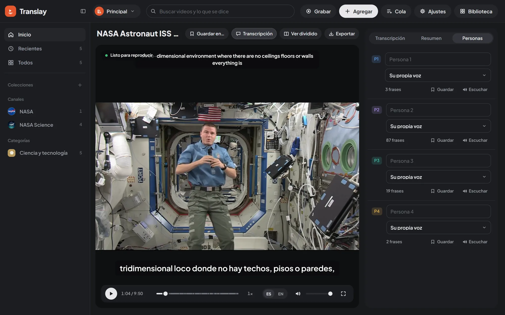

import { Aside } from "@astrojs/starlight/components";

El panel al costado del video tiene hasta cuatro pestañas: «Transcripción», «Resumen», «Siguientes» y «Personas». «Resumen» aparece cuando el video ya tiene transcripción; las dos últimas, solo cuando tienen algo que mostrar. Se oculta con el botón «Transcripción» de la barra del video o con el botón junto al logo.

## Transcripción

Cada frase ocupa una fila con el original y el español lado a lado (una sola columna, en su idioma, si el video solo se transcribe), la hora en que empieza y, si en el video habla más de una persona, quién la dice. Las frases llegan a medida que se procesan; una raya («—») marca las que aún no tienen traducción.

La frase que suena queda resaltada y el panel la sigue solo. Si te desplazas a mano, deja de seguirla unos segundos. Un clic en una frase salta a ese momento del video.

## Resumen

La pestaña «Resumen» cuenta de qué se trató el video: primero unos párrafos con el tema, cómo se desarrolla y a qué conclusiones llega; después todos sus puntos importantes, cada uno con el minuto en que se dice. Un clic en un punto salta a ese momento, y el punto que se está viendo queda resaltado como la frase de la transcripción. No hay un número fijo de puntos: un video largo tiene más (una clase de 43 minutos salió con unos 60, una charla de 14 minutos con unos 24).

Por defecto se hace cuando lo pides: **Resumir** en la pestaña, cuando la transcripción está completa. El botón muestra cómo va («Resumiendo 40 %») y **Cancelar** lo detiene. Con Preferencias › Resumen › **Resumir** › **Al procesar cada video**, cada video se resume solo apenas la cola lo termina. La primera vez se descarga el modelo de resumen (el botón muestra su avance).

El resumen queda en español sea cual sea el idioma del video, se guarda con el video y se ve desde todas las pestañas. Su menú del clic derecho tiene **Copiar el resumen**, **Exportar el resumen** (en TXT) y **Rehacer el resumen** (por ejemplo, con otro modelo).

Se hace en tu equipo, con un modelo de lenguaje pequeño elegido según tu equipo (Preferencias › Resumen › **Modelo**). Mientras resume tiene la GPU para sí: si el resto de los modelos de Translay no caben a su lado, se apartan y vuelven al terminar, así que lo que se esté procesando espera un momento. Cómo funciona y cómo se eligieron los modelos: [Resumen](../../how-it-works/summary/).

## Comentarios

El botón **+** de cada frase («Comentar esta frase») abre un cuadro para escribir una nota. <kbd>Ctrl</kbd> + <kbd>Enter</kbd> la guarda y <kbd>Esc</kbd> cancela. Una frase con comentarios muestra cuántos tiene en ese mismo botón, que sirve para agregar otro. Cada comentario lleva su fecha y se puede editar («Editar») o eliminar («Eliminar»).

Sobre la línea de avance del reproductor, un puntito marca cada frase comentada: al pasar el mouse se lee el comentario y un clic salta a esa frase.

Los comentarios se guardan en la transcripción del video, se ven en todas las pestañas abiertas, entran en la [búsqueda](../glossary-and-search/#búsqueda) y en la transcripción que se [exporta](../export/) como TXT.

## Personas

Translay distingue a las personas que hablan por su voz y dobla a cada una con su propia voz clonada. La pestaña «Personas» aparece en cuanto el video tiene alguna identificada, con una fila por persona (P1, P2…) y cuántas frases dice.

En cada fila puedes:

- **Ponerle nombre.** Reemplaza a «P1» en la transcripción y en el TXT exportado.
- **Elegir su voz en español.** «Su propia voz» (o «Su voz (aún sin referencia)», si todavía no hay un fragmento suyo lo bastante limpio), la voz de otra persona del mismo video o la de una persona guardada en la biblioteca. Al cambiarla, sus frases se vuelven a doblar en la cola.
- **«Escuchar»** la voz de referencia que se está usando. El mismo botón la pausa.
- **«Guardar»** a la persona en la biblioteca, con su nombre y su voz. Si ya hay una guardada con el mismo nombre, el botón dice «Actualizar voz».

## Personas guardadas

Una persona guardada queda en la biblioteca abierta (carpeta `people/`) y aparece en el selector de voz de cualquier video de esa biblioteca, en el grupo «Guardadas en» y el nombre de la biblioteca. Sirve para que alguien que aparece en varios videos suene siempre igual, o para darle a una persona la voz de otra.

Al final de la pestaña está la lista de guardadas, cada una con «Escuchar» y «Olvidar». Al olvidar a una persona, los videos que usaban su voz vuelven a la voz de cada persona cuando se rehacen.

<Aside>
Cómo se arma la referencia de voz de cada persona y cómo se clona: [Voz](../../how-it-works/voice/).
</Aside>
