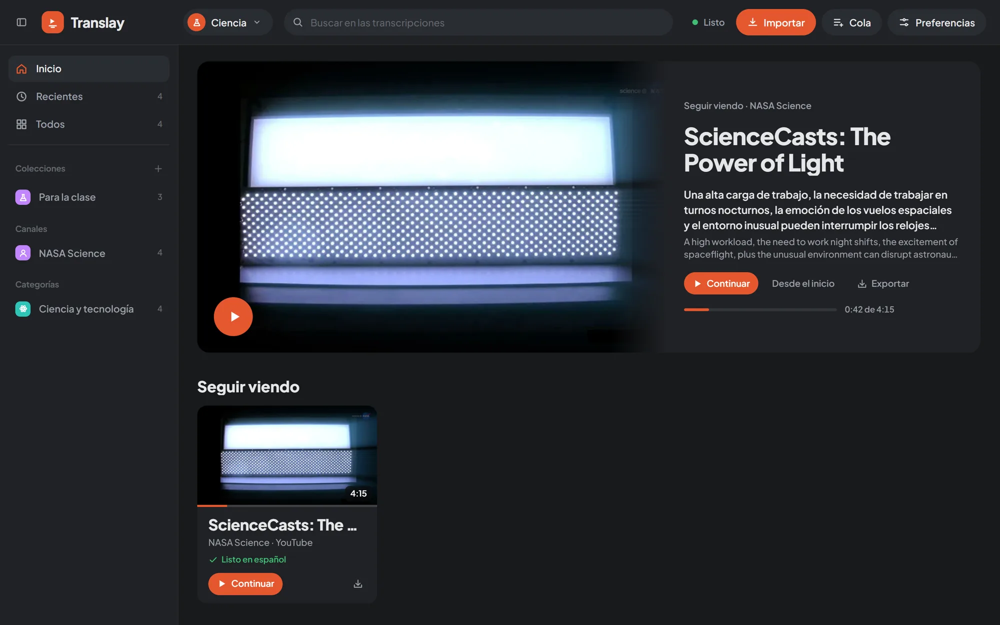
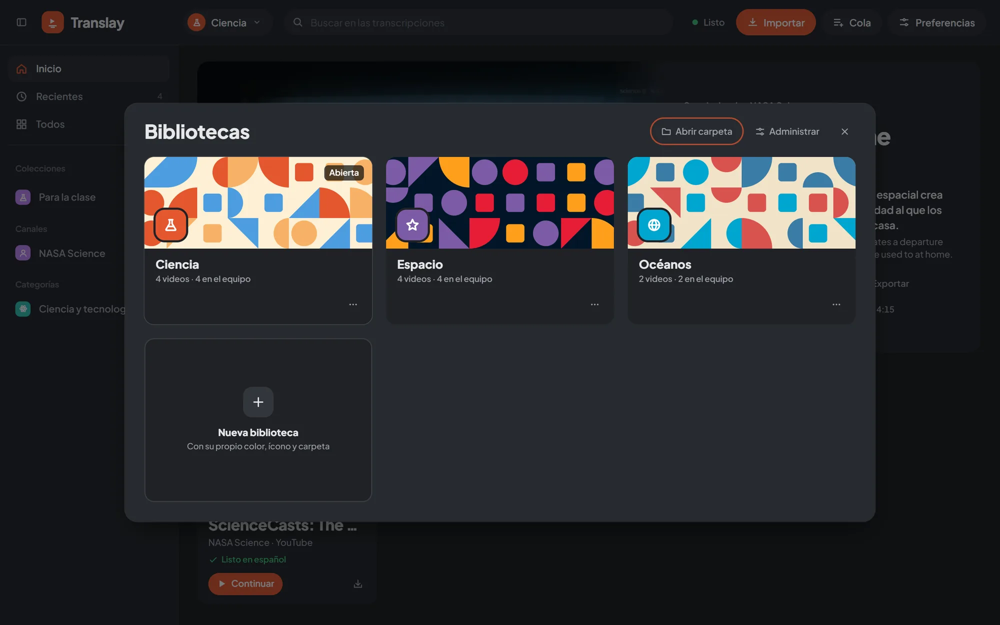

import { Card, CardGrid } from "@astrojs/starlight/components";
import Bauhaus from "../../../components/Bauhaus.astro";

<Bauhaus seed="translay" main="#e4572e" cols={24} />

<CardGrid>
  <Card title="Doblaje con su propia voz" icon="seti:audio">
    Whisper reconoce, Opus-MT traduce y OmniVoice clona la voz de cada persona del video. La voz suena sincronizada con la imagen.
  </Card>
  <Card title="YouTube y archivos" icon="seti:video">
    Pega un enlace, una playlist o un CSV con miles de enlaces; se descargan y procesan solos en una cola.
  </Card>
  <Card title="Bibliotecas" icon="open-book">
    Colecciones, canales, categorías y búsqueda en todas las transcripciones. Cada biblioteca en su carpeta.
  </Card>
  <Card title="App de escritorio" icon="laptop">
    Un instalador para Windows: la app prepara sola Python, el servidor y el motor de voz, y abre Translay en su propia ventana.
  </Card>
  <Card title="API y webhooks" icon="puzzle">
    Todo lo que hace la app también por HTTP, con claves por biblioteca y avisos firmados.
  </Card>
</CardGrid>

## Así se ve

Las capturas son de una instancia de prueba con videos de dominio público de la NASA y la NOAA.

## Por dónde seguir

- [Instalación](getting-started/install/) en Windows con el instalador, [desde el código](getting-started/from-source/) o [con Docker](getting-started/docker/).
- [Tu primer video](getting-started/first-video/), de pegar el enlace a escucharlo en español.
- [Cómo funciona](how-it-works/architecture/) por dentro, si vas a modificarlo.
- [Cambios](changelog/) de cada versión y las [versiones publicadas](https://github.com/alenj0x1/translay/releases).
- El código, los reportes de errores y las propuestas, en [GitHub](https://github.com/alenj0x1/translay).
