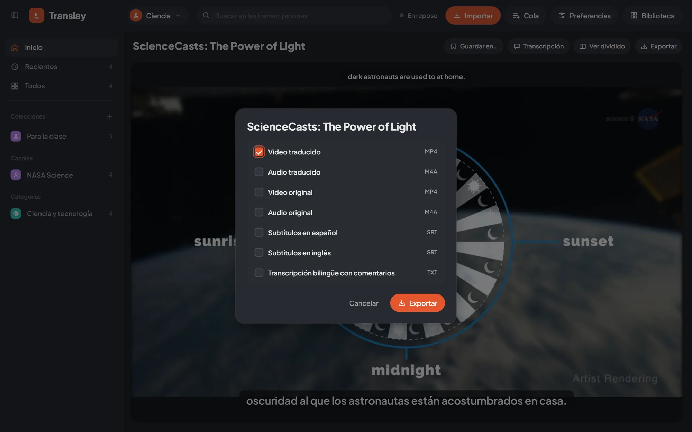

import { Aside } from "@astrojs/starlight/components";

## Qué se puede exportar

En el cuadro de exportar marcas cualquier combinación de:

| Opción | Formato | Contenido |
|---|---|---|
| Video traducido | MP4 | La voz en español como pista principal, el inglés como segunda pista y subtítulos en español e inglés que se activan en el reproductor. |
| Audio traducido | M4A | La mezcla en español. |
| Video original | MP4 | El video tal como se descargó o importó. |
| Audio original | M4A | La pista de audio original. |
| Subtítulos en español | SRT | La traducción, con sus tiempos. |
| Subtítulos en inglés | SRT | Lo que se dice en inglés. |
| Transcripción bilingüe con comentarios | TXT | Cada frase con su hora, la persona que habla (con su nombre, si se lo pusiste), el inglés, el español y los comentarios. |

La mezcla en español es la misma que escuchas en el reproductor: cada frase doblada en su momento y el original de fondo, al nivel de Preferencias › Audio y subtítulos › «Original bajo la voz en español». Donde nadie habla, el original queda a volumen normal. Se arma con ffmpeg en la CPU, así que no le quita GPU al procesamiento.

## Desde dónde

- **Reproductor**: «Exportar» en la barra del video, para el video abierto.
- **Tarjeta**: el ícono de descarga, o «Exportar…» en su menú contextual.
- **Colección o playlist**: «Exportar» en su cabecera, o «Exportar todo…» en el menú contextual.
- **Selección**: «Exportar» con varios videos elegidos.
- **Portada**: «Exportar» junto al video destacado.

## Un archivo o un .zip

Si el resultado es un solo archivo, se descarga tal cual, con el título del video en el nombre. Si son varios (varios videos o varios tipos), van juntos en un `.zip`.

El avance se ve en el panel «Cola», en la sección «Exportar», y la descarga empieza sola al terminar en la pestaña que la pidió. Si la cerraste, el archivo queda en el panel con «Descargar» mientras el servidor siga corriendo. Al arrancar, el servidor borra las exportaciones de más de un día.

## Si el video aún no está listo

El cuadro avisa antes de exportar qué va a tener que esperar:

- **Lo traducido** (video o audio) espera a que el doblaje termine. Si el video no estaba en la cola, entra solo; mientras tanto el panel muestra cuánto lleva el doblaje.
- **Los subtítulos y el TXT** solo esperan la transcripción completa, no el doblaje.
- **Un video sin descargar** se descarga primero.
- **Un video del que solo se bajó el audio**: si pides un video (original o traducido), se descarga el video completo primero.

Puedes cancelar una exportación en curso desde el panel de la Cola con «Cancelar».

<Aside>
El código de la exportación está en `vt/exporter.py`. También se puede pedir por la [API](../../integraciones/api/).
</Aside>
