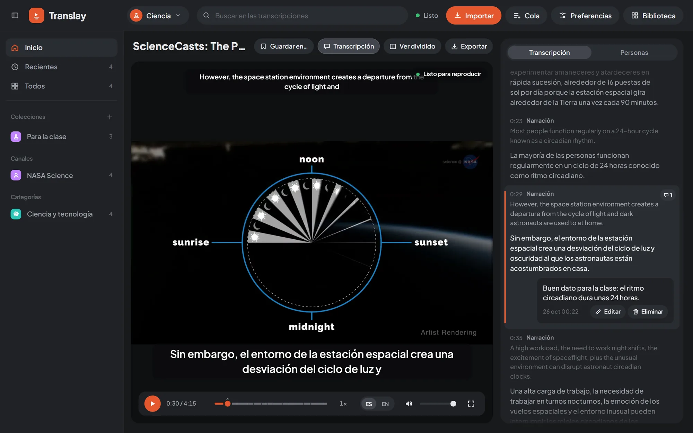
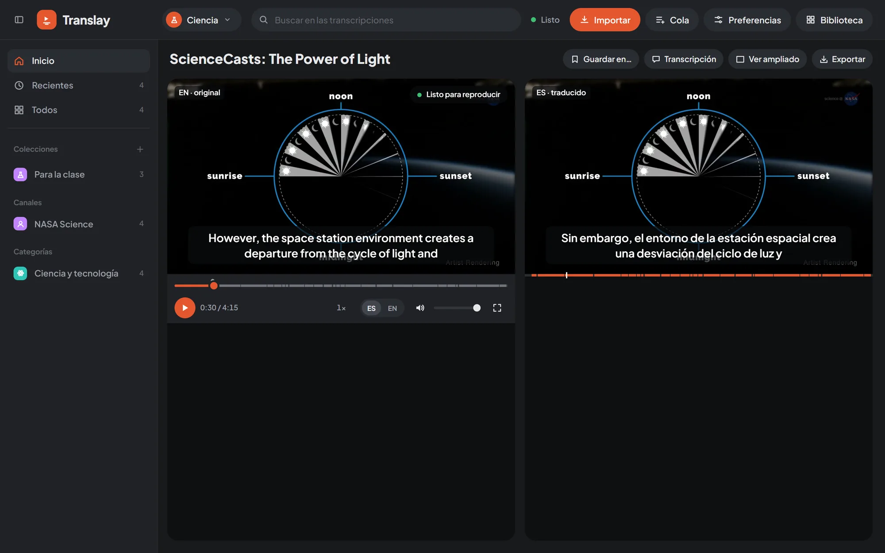

import { Aside } from "@astrojs/starlight/components";

Sobre el video está su título y sus acciones: «Guardar en…», «Transcripción» (muestra u oculta el panel lateral), «Ver dividido» y «Exportar». El botón «Biblioteca» del encabezado vuelve a la biblioteca; desde ahí, «Volver al video» regresa.

## Vista ampliada y dividida

- **Ampliada** (por defecto): un solo video grande, con el subtítulo en español abajo y el inglés pequeño arriba, y la transcripción al costado.
- **Dividida**: el original («EN · original») y el traducido («ES · traducido») lado a lado. Bajo el video en español, una línea marca las frases ya traducidas.

El botón «Ver dividido» o «Ver ampliado» cambia entre las dos y la elección se guarda (Preferencias › Reproducción › «Vista del video»). Los subtítulos de cada idioma se pueden apagar en Preferencias › Audio y subtítulos.

## Controles

Los controles son propios y se esconden solos a los pocos segundos mientras el video se reproduce; vuelven al mover el mouse o tocar una tecla.

- **Reproducir o pausar**, también con un clic sobre el video.
- **Tiempo** transcurrido y total.
- **Línea de avance**: además de lo reproducido, una franja tenue marca lo ya reconocido y otra más marcada lo que ya tiene voz en español (o traducción, si la app corre sin voz). Al pasar el mouse muestra el tiempo; los puntitos son [comentarios](../transcripcion-y-personas/#comentarios).
- **Velocidad**: cada clic pasa al siguiente valor entre 0,75× y 2× (de a 0,25). La voz en español acelera sin cambiar de tono. La velocidad elegida se recuerda en el navegador.
- **ES / EN**: ES es la voz en español con el original de fondo; EN, el original a volumen normal. Con qué idioma empieza cada video y qué tan fuerte queda el original bajo la voz se elige en Preferencias › Audio y subtítulos.
- **Volumen** y silencio.
- **Pantalla completa**, también con doble clic sobre el video.

## Atajos de teclado

Funcionan en el reproductor, fuera de los campos de texto.

| Tecla | Acción |
|---|---|
| <kbd>Espacio</kbd> o <kbd>K</kbd> | Reproducir o pausar |
| <kbd>←</kbd> / <kbd>→</kbd> | 5 segundos atrás o adelante |
| <kbd>F</kbd> | Pantalla completa |
| <kbd>M</kbd> | Silenciar o volver a escuchar |
| <kbd>Shift</kbd> + <kbd>{"<"}</kbd> / <kbd>{">"}</kbd> | Bajar o subir la velocidad |

En la biblioteca, <kbd>/</kbd> lleva al campo de búsqueda (ver [Glosario y búsqueda](../glosario-y-busqueda/#búsqueda-en-las-transcripciones)).

## Cuándo está listo

Un video se procesa mientras lo ves: el servidor empieza desde tu punto de reproducción y, si saltas a una parte sin terminar, salta contigo. Para saber si conviene darle reproducir, sobre el video aparece un indicador:

- **«Preparando NN %»**: cuánto falta para tener margen suficiente.
- **«Listo para reproducir»**: lo doblado por delante alcanza para escuchar sin cortes.
- **«Cargando modelos»**: los modelos están volviendo del [modo reposo](../../funcionamiento/gpu-y-reposo/).

El indicador compara lo ya doblado por delante del punto de reproducción con la velocidad real del procesamiento. Por defecto se ve en pausa y, reproduciendo, solo si el margen se queda corto; Preferencias › Reproducción › «Indicador de reproducción» permite mostrarlo siempre o nunca.

## Reproducción automática

Con Preferencias › Reproducción › «Reproducir al abrir un video», el video empieza solo en cuanto está listo para escucharse sin cortes.

Con «Pausar hasta que esté listo», si llegas a una parte que aún no tiene voz en español (por un salto, o porque el doblaje se quedó atrás), el video se pausa, el indicador dice «Sigue al estar listo NN %» y se reanuda solo. Si le das reproducir a mano antes, sigue igual, sin esperar, hasta el próximo salto. Esta pausa solo actúa escuchando en español.

## Siguientes

Cuando abres un video desde una colección, una playlist o una fila de la portada, la pestaña «Siguientes», junto a «Transcripción», muestra esa lista con el video actual marcado. Con «Abrir» sobre una selección, muestra los elegidos.

Al terminar un video sigue el próximo de la lista (Preferencias › Reproducción › «Reproducir el siguiente al terminar»). Si el próximo aún no está descargado, se descarga con prioridad y se abre al terminar. La pestaña solo aparece cuando la lista tiene más de un video.

## Miniatura flotante

Si vas a la biblioteca, a la Cola o a Preferencias con el video reproduciéndose, sigue en una miniatura abajo a la derecha, con «Volver al video» y «Cerrar». Si lo dejas en pausa, no se muestra: el video queda guardado hasta que vuelvas.

<Aside>
Cada tramo procesado queda guardado. Al retroceder o volver a abrir un video, la transcripción, la traducción y las voces salen del disco; solo se procesa lo nuevo. Cómo funciona por dentro: [Pipeline](../../funcionamiento/pipeline/).
</Aside>
