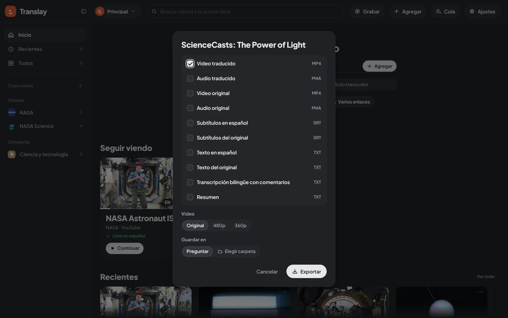

import { Aside } from "@astrojs/starlight/components";

## What you can export

In the export dialog you check any combination of:

| Option | Format | Content |
|---|---|---|
| **Video traducido** (Translated video) | MP4 | The Spanish voice as the main track, the original as a second track (tagged with its real language, e.g. `por`), and Spanish and original subtitles that you switch on in the player. |
| **Audio traducido** (Translated audio) | M4A or MP3 | The Spanish mix. |
| **Video original** (Original video) | MP4 | The video as it was downloaded or imported. |
| **Audio original** (Original audio) | M4A or MP3 | The original audio track. |
| **Subtítulos en español** (Spanish subtitles) | SRT | The translation, with its timings. |
| **Subtítulos del original** (Original subtitles) | SRT | What is said, in the video's language; the file is named with its code (`.en.srt`, `.pt.srt`…). |
| **Transcripción bilingüe con comentarios** (Bilingual transcript with comments) | TXT | Each sentence with its time, the speaker (by name, if you set one), what is said, its translation (only if the video is translated) and the comments. |

The Spanish mix is the same one you hear in the player: each sentence dubbed at its moment and the original in the background, at the level set in Preferences › Audio y subtítulos › **Original bajo la voz en español** (Original under the Spanish voice). Where nobody speaks, the original stays at normal volume. It is built with ffmpeg on the CPU, so it doesn't take GPU away from processing.

When you check an audio option, **Formato del audio** (Audio format) lets you choose **M4A** (AAC, 160 kbps) or **MP3** (192 kbps, plays on any device or car stereo). The browser remembers your choice. The translated video always carries AAC inside the MP4.

## From where

- **Player**: **Exportar** (Export) in the video bar, for the open video.
- **Card**: the download icon, or **Exportar…** in its context menu.
- **Collection or playlist**: **Exportar** in its header, or **Exportar todo…** (Export all…) in the context menu. If part of the collection hasn't been downloaded, the header button reads **Exportar descargados (N)** (Export downloaded) and only exports what is already on your computer, so it never goes to YouTube; **Exportar todo…** still exports everything.
- **Selection**: **Exportar** with several videos selected.
- **Home**: **Exportar** next to the featured video.

## One file or a .zip

If the result is a single file, it downloads as is, with the video title in the name. If there are several (several videos or several types), they come together in a `.zip`.

When you export several videos, the `.zip` uses folders like the groups in the sidebar:

- **From a channel, collection, playlist or category** (its export button, «Exportar todo…» in its menu, or videos you picked inside it), everything goes in one folder with its name: `Anthropic/…`. There's nothing to choose.
- **From Todos, Recientes or a search**, the videos can come from many places, so **Carpetas** (Folders) lets you choose, and the browser remembers your choice:

| Option | Inside the `.zip` |
| --- | --- |
| **Canales** (Channels, the default) | One folder per channel: `Anthropic/…`, `Another channel/…`. Videos without a channel (files, recordings) go to `Sin canal`. |
| **Colecciones** (Collections) | One folder per collection of yours. A video in several goes to the first one; one in none goes to `Sin colección`. |
| **Playlists** | One folder per imported playlist; the rest go to `Sin playlist`. |
| **Sin carpetas** (No folders) | Every file at the top. |

Only the groups the chosen videos belong to show up (no playlists, no **Playlists**). Categories aren't an option: a video usually has several, and no file is repeated. The API takes `"layout": "flat|channel|collection|playlist|folder"` (flat by default) and, with `folder`, the folder's name in `"folder"`.

A batch converts several videos at once (up to six, half of your processor's threads), and each file goes into the `.zip` as soon as it's ready, so the disk only holds the `.zip` and not a loose copy of each file too. If you cancel, what had been made is deleted.

Progress shows in the **Cola** panel, in the **Exportar** section, and the download starts on its own when it finishes in the tab that requested it. If you closed it, the file stays in the panel with **Descargar** (Download) as long as the server keeps running. On startup, the server deletes exports older than a day.

## If the video isn't ready yet

The dialog tells you before exporting what it will have to wait for:

- **Translated content** (video or audio) waits for dubbing to finish. If the video wasn't in the queue, it is added automatically; meanwhile the panel shows how far dubbing has got.
- **Subtitles and the TXT** only wait for the full transcription, not dubbing.
- **A video that hasn't been downloaded** is downloaded first.
- **A video that is only transcribed** has no translation or voice: the translated options are skipped for it, and if nothing else was checked it goes to `omitidos.txt`.
- **A video of which only the audio was downloaded**: if you ask for a video (original or translated), the full video is downloaded first.

If one video of a batch can't be exported (for example, it was removed from YouTube and has no copy on your computer), it is skipped and the rest continue: the `.zip` includes `omitidos.txt` with each skipped video and the reason, and the panel says how many were left out. Only when it's a single video, or none could be exported, does the export end in an error, with the reason in plain words.

You can cancel an export in progress from the Queue panel with **Cancelar** (Cancel).

<Aside>
The export code is in `vt/exporter.py`. You can also request it through the [API](../../integrations/api/).
</Aside>
