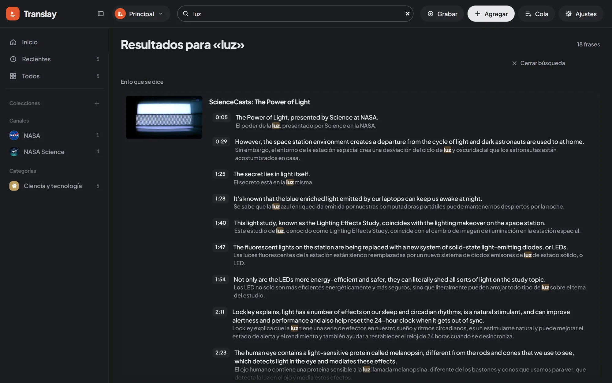

import { Aside } from "@astrojs/starlight/components";

## Glossary

The glossary is in Preferences › **Glosario** (Glossary). Each row is a term as it is said in the video (in any language Translay translates) and, on the right, how it is always translated:

| Term | Translation | Result |
|---|---|---|
| `Jupyter Notebook` | (empty) | Stays as in the original. Useful for names, brands and acronyms. |
| `prompt` | `instrucción` | Always translated as "instrucción". |

**Agregar término** (Add term) adds a row, **Quitar** (Remove) deletes it and **Guardar glosario** (Save glossary) applies it. Each library has its own glossary.

Terms are matched as whole words and ignoring case: `prompt` does not change inside "prompts" or "prompt-based". If a term is inside a longer one ("Notebook" and "Jupyter Notebook"), the longer one is used. Before translating, each term is swapped for a placeholder that the translator leaves untouched and then restored with its fixed translation (`vt/glossary.py`).

### What happens when you save it

The glossary is applied to what is already translated, not only to new content. When you save it, the sentences in the library that contain an added, changed or removed term are translated again, and the voice for those sentences is redone in the queue. When it finishes, a notice says how many sentences and videos changed.

## Search

The **Buscar videos y lo que se dice** (Search videos and what is said) field in the header searches the open library. In the library, the <kbd>/</kbd> key takes you straight to the field; from another screen, tapping it takes you back to the library.

Results come in up to three groups:

| Group | What it shows |
|---|---|
| **Videos** | Videos whose title or channel matches, as normal cards (up to 12). |
| **Colecciones y canales** (Collections and channels) | Collections, playlists, categories and channels whose name matches (up to 24); a click opens it. |
| **En lo que se dice** (In what is said) | Sentences that match in what is said, in the translation and in the [comments](../transcript-and-people/#comments), grouped by video with the one that has the most matches first. Each one shows the time of the sentence; one click opens the video just before that moment. |

The header counts what was found, for example "2 videos · 5 frases · 1 colección" (2 videos · 5 sentences · 1 collection). If nothing matches, it says that no video, collection or channel is called that and nobody says it.

- Accents and case don't matter: "cancion" finds "canción".
- It searches as you type, from two letters on.
- The match is underlined.

<kbd>Esc</kbd> or **Cerrar búsqueda** (Close search) goes back to the collection you were in.

<Aside>
Up to 20 matches per video and up to 100 videos are shown; the total number of matches appears above the results.
</Aside>
