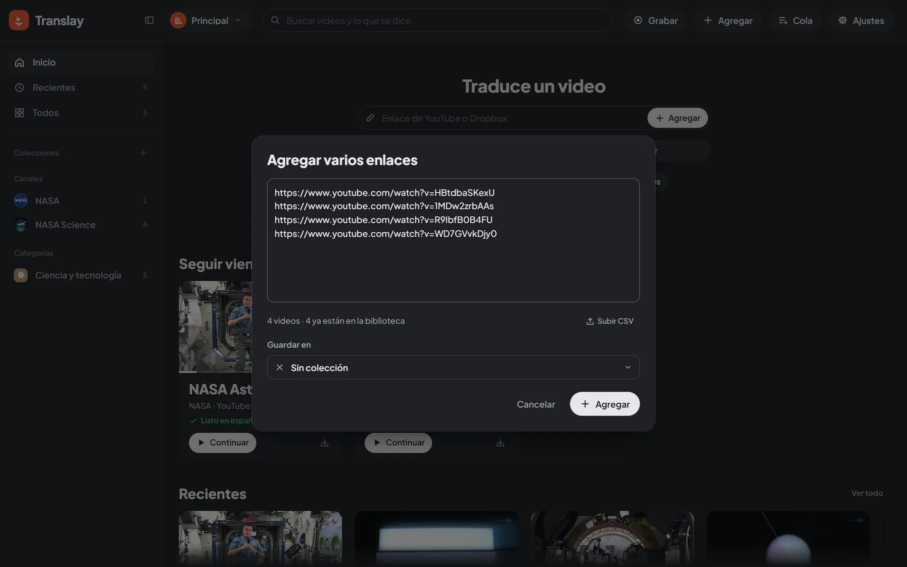

import { Aside } from "@astrojs/starlight/components";

Everything you add goes straight to the server's queue: it appears instantly in the library, dimmed and with its status, and keeps downloading and processing even if you reload or close the page.

## «Grabar» and «Agregar»

The header has two buttons, no split buttons:

- **«Grabar»** (Record) opens screen recording directly (only in browsers that support it; see [Record the screen](#record-the-screen)).
- **«Agregar»** (Add) opens a panel with the «Enlace de YouTube o Dropbox» (YouTube or Dropbox link) field and its «Agregar» button, a choice between **«Traducir y doblar»** (Translate and dub) and **«Solo transcribir»** (Only transcribe) for what you add (remembered in this browser), and one row per source, each saying what it accepts: «Subir archivos» (Upload files · videos or audio; a .csv with links works too), «Grabar pantalla» (Record screen · a tab, a window or the whole screen, with its sound) and «Varios enlaces» (Several links · playlists and channels too). On a phone the rows show only the action, and «Grabar» is only in this panel. Pressing «Agregar» or Enter without a YouTube or Dropbox link shows a notice saying what's missing.

The home page always starts with the same at hand: a box («Traduce tu primer video», Translate your first video, with an empty library; «Traduce un video», Translate a video, afterwards, or «Transcribe…» when only transcribing; while it's visible, the header's «Agregar» is a regular button) with the link field, the choice to translate or only transcribe, «Subir archivos», «Grabar pantalla» and «Varios enlaces». A link pasted anywhere (Ctrl+V) is added, and dragging files onto the window shows «Suelta para agregar» (Drop to add).

## YouTube links

In the panel, «Agregar» becomes active when the field has a valid link: a video (`watch?v=`, `youtu.be/`, `shorts/`, `live/`), a playlist or an 11-character id.

You can also paste a link anywhere on the page, outside a text field, or open the app with `?yt=<link or id>` in the address.

Outside the player, an added video doesn't open: it enters the queue and appears in Recientes (Recent). When you want to watch it, open it from its card.

## Dropbox links

A Dropbox shared link to a video or audio file is added like a YouTube video: it enters the queue, downloads with its progress on the card and the card says «Dropbox». It works with a single file (`dropbox.com/scl/fi/…/clase.mp4`) and with a file inside a shared folder (`dropbox.com/scl/fo/…/21_10.mp4`); a link to the whole folder is rejected, because Dropbox would hand over a zip. The link has to be public («Anyone with the link»).

Translay changes `dl=0` to `dl=1` to get the file directly and drops the tracking parameters (`st`, `e`), so the same link pasted twice is the same video. The file is stored in the library's `library/` folder, next to its audio track and a thumbnail taken from the video. With «Solo el audio» (Audio only) the whole file is still downloaded (Dropbox can't send just the audio) but only the audio is kept.

## Language and transcribe only

You don't say what language a video is in: Translay detects it from the first seconds of speech (English, Portuguese or Spanish; see [Languages](../../how-it-works/languages/)). The arrow next to «Agregar» in the panel has two options for what you're adding right now (YouTube or Dropbox, one link or several):

- «Agregar y traducir» (Add and translate): translated and dubbed into Spanish. A video detected in the language set in Settings › Agregar y descargar › «Solo transcribir lo que está en» (Only transcribe what is in; Spanish by default) is only transcribed.
- «Agregar y solo transcribir» (Add and only transcribe): transcribed in its own language and that's it, whatever the language: no translation or voice, it plays with the original audio and a single subtitle, the transcript shows one column and the card says «Transcrito» (Transcribed) when it's done.

A language Translay can't translate yet is only transcribed in that language.

To change it later, use «Idioma y traducción» (Language and translation) in the video's context menu. «Se habla en» (Spoken in) corrects the language: what was transcribed in the other one is deleted and the video is processed again, so it asks first. «Traducir y doblar» (Translate and dub) and «Solo transcribir» (Transcribe only) switch the mode without deleting anything: the recognized text works for both and translations are kept.

<Aside>
The light profiles («Ligero» and «Subtítulos ligeros») use Whisper `small`, which recognizes every language but makes more mistakes in Portuguese than in English (see [Performance](../performance/)). A `.en` model passed with `--model` only recognizes English: a video in another language ends with an error that tells you to change the profile.
</Aside>

## Several links

If you paste text with more than one link (or use «Varios enlaces» in the panel), the «Agregar varios enlaces» (Add several links) dialog opens so you can review them first; its «Agregar» button adds them. It takes YouTube and Dropbox links from anywhere in the text (one per line, separated by commas, or mixed with other text) and shows a summary: how many videos, how many playlists and how many are already in the library. Duplicates count only once.

In «Guardar en» (Save to) you choose one of your collections or a category for what you add; all YouTube categories appear even if you don't have videos in them yet.

With thousands of links, videos appear right away with their id and titles are filled in gradually, with few requests at a time so it doesn't look like a burst to YouTube.

## Playlists

A playlist link (`list=…`) is added as a collection, marked «Playlist», and all its videos enter the queue in order. Pasting it again updates it.

If the link is for a video inside a playlist, Translay asks «Este enlace es de una playlist» (This link is from a playlist) with two options: «Solo este video» (Only this video) or «Agregar playlist» (Add playlist). While you are watching a video it doesn't ask: only that video is added.

YouTube's automatic mixes (lists that start with `RD` or `UL`) have no end, so they are treated as a single video.

## From a CSV

«Archivos» in the panel accepts a `.csv`, and you can also drag it onto the page or use «Subir CSV» (Upload CSV) inside the several-links dialog. Translay takes:

- YouTube and Dropbox links from any column.
- Loose 11-character ids from a column named `id`, `video_id`, `youtube_id` or `yt_id`.

The separator can be a comma, semicolon or tab. The links found open in the several-links dialog so you can review them before adding them.

## Files from your machine

«Archivos» in the panel (or «Subir» when the button shows it, or dragging onto the page) accepts videos and audio files. Each file is copied to the open library's `library/` folder, with a thumbnail taken from the video, and enters the queue. It is recognized by a fingerprint of its content, so renaming it doesn't duplicate it.

## Record the screen

«Grabar pantalla» (Record screen), in the «Agregar» panel (or «Capturar» when the button shows it), records a browser tab, a window or the whole screen and adds it to the library like any other video. It needs a computer browser (Chrome or Edge) and the page opened on this computer or over `https`. After you pick a window or a tab, Translay stays in front instead of hiding behind it.

Only a tab brings just its own sound. A window or the whole screen brings the sound of the whole computer, a call or notifications included, and the dialog says so before you record.

1. The browser asks what to share. To have something to translate, the source must carry sound: a tab, or the whole screen with «Compartir audio» (Share audio) turned on. A single window usually has no sound on Windows; if so, the dialog says so and «Elegir otra» (Choose another) opens the picker again.
2. In the preview, moving the cursor highlights the boxes it finds: where the picture keeps moving (a video, even one that only takes up part of a page) and boxes with straight edges (windows, panels, players). A click picks the highlighted box, the mouse wheel jumps to the box that contains it, and dragging marks a zone by hand. «Toda la imagen» (Whole picture) goes back to recording everything.
3. Choose the quality; under it you see the size of the final file and the most it will weigh per minute and per hour:

| Quality | Maximum height | Video cap at 30 fps |
|---|---|---|
| Alta (High) | 1080p | 4 Mbit/s |
| Media (Medium, default) | 720p | 2 Mbit/s |
| Ligera (Light) | 480p | 0.9 Mbit/s |
| Solo audio (Audio only) | — | M4A at 96 kbit/s |

At 15 frames per second the cap is two thirds; a smaller zone weighs proportionally less. It is a ceiling: a screen with little movement usually weighs much less.

4. «Grabar» (Record). A bar at the bottom shows the time, the estimated size and the sentence just translated: the recording is transcribed and translated live. «Detener» (Stop), or the browser's «Dejar de compartir» (Stop sharing), ends it.

When it stops, the server puts the file together (cropped to the zone and compressed to H.264 + AAC) and it enters the queue, which completes the dubbing.

If what you record changes shape halfway (you switch from sharing a phone to a desktop screen, or a phone rotates), the video adapts: the final file uses a frame that fits both, at the quality's height and the width of the widest, and each part fits inside without stretching, with black bands where there is room left. The chosen zone is dropped in that case, since it belonged to the other source.

If the source stops sending picture (a minimized window, a locked or disconnected phone), the bar says «Lo que se graba no envía imagen» (What is recorded sends no picture). If it disappears or the browser stops sharing it, the recording ends and is saved on its own, with a notice.

<Aside title="Nothing is lost if the connection drops">
Each second of recording is saved in the browser before it is uploaded, and deleted only once the server confirms it. Without a connection the recording continues («Sin conexión, se guarda en este equipo», No connection, saved on this computer) and the upload resumes when the connection is back; the live transcription reconnects on its own and resends what it had not confirmed (it doesn't count as being offline: whatever it misses, the queue completes with the final file). If the server rejects the recording, it says why instead of retrying forever. If you close the tab or the computer shuts down, the next time you open Translay it finishes uploading what was recorded and puts it together.
</Aside>

## Add to a collection

In a custom collection or a category, the «Agregar» button in its header (or «Agregar aquí…» (Add here…) in the context menu) opens the several-links dialog with that collection already chosen in «Guardar en». If the collection is empty, the button appears in the center.

A video added to a category appears in it even if YouTube has it in another.

## Download only or translate

Ajustes › Agregar y descargar › «Al agregar» (Settings › Add and download › "On add") decides what is done with new items:

- **Descargar y traducir** (Download and translate) (default): it is downloaded, translated and dubbed.
- **Solo descargar** (Download only): it is downloaded without using the GPU and stays «Descargado, sin traducir» (Downloaded, not translated). Useful for watching or exporting the original. When you want to translate it, use «Procesar» (Process) on its card or in the Cola; opening it to watch also processes it.

On a YouTube or Dropbox video not yet downloaded, «Ver ▾» › «Descargar sin abrir» (Watch ▾ › Download without opening) downloads it with priority without opening or translating it.

## Audio only

Ajustes › Agregar y descargar › «Qué descargar» › «Solo el audio (más rápido)» (What to download › Audio only (faster)) downloads only the audio track. It is translated and dubbed all the same; the player shows the thumbnail instead of the picture and the card carries the «Solo audio» (Audio only) label.

To get the picture afterward, use «Bajar video» (Download video) on the card (or in the selection): the full video is downloaded without translating again. If you export a video, original or translated, the full video is downloaded first.

These two preferences are specific to each [library](../libraries/).

## While you watch a video

The «Agregar» button remains available in the player. What happens with what you add is decided by Ajustes › Reproducción › «Al agregar un video mientras ves otro» (Settings › Playback › "When adding a video while watching another"):

| Option | What it does |
|---|---|
| Ponerlo a continuación (Put it next) (default) | It enters the queue and sits right after the current one in «Siguientes» (Up next). |
| Procesarlo en segundo plano (Process it in the background) | It only enters the queue. |
| Abrirlo (Open it) | It is downloaded with priority and opens as soon as it finishes. With files from your machine, the first one opens and the rest stay in «Siguientes». |

<Aside>
Videos that are already in another library aren't duplicated: they stay there and a notice says so. See [Libraries](../libraries/#move-videos).
</Aside>
