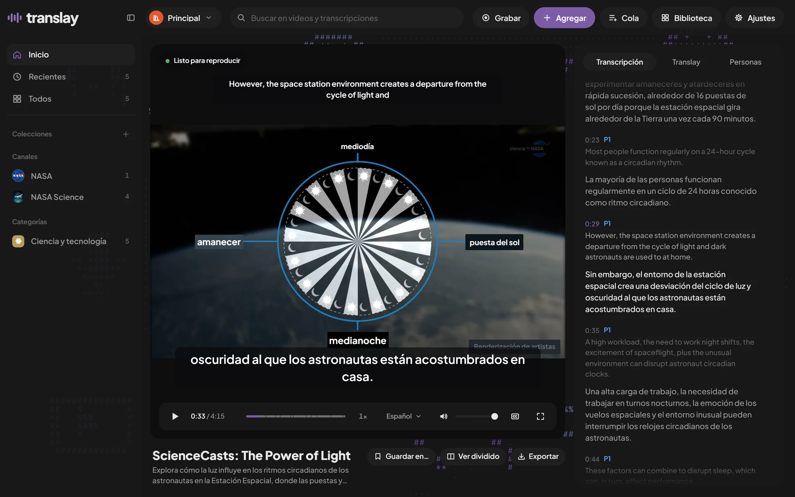
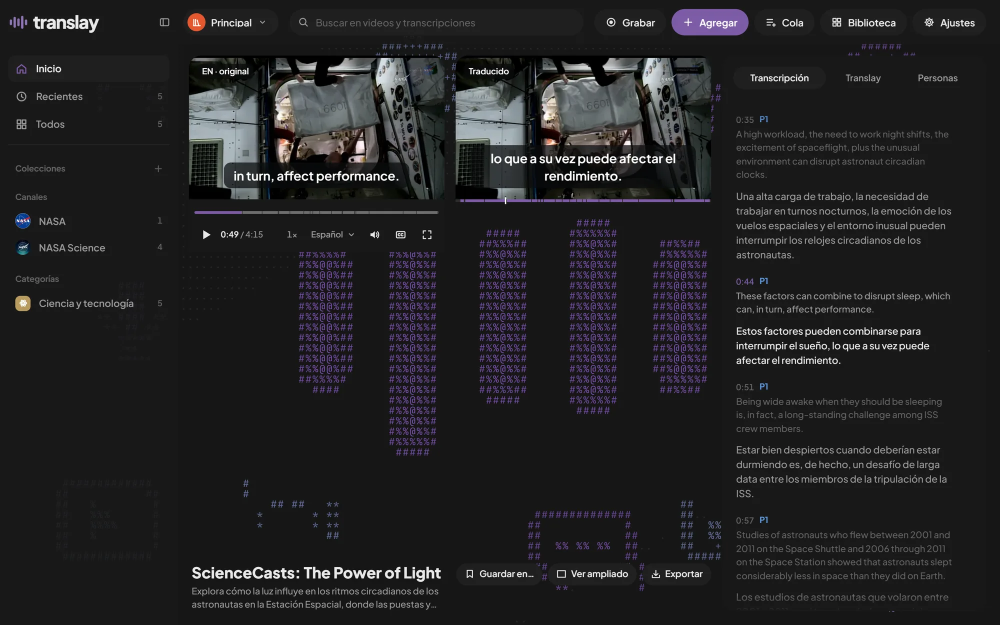

import { Aside } from "@astrojs/starlight/components";

Above the video are its title, a short description of what it is about and its actions. The description (one or two sentences) is written by the agent's smallest model (Qwen3.5 0.8B, downloaded the first time) when the video finishes processing, or when you open one that doesn't have it yet; if the video already has its summary, it takes its first sentences. The actions are «Guardar en…» (Save to…), «Ver dividido» (Split view) and «Exportar» (Export). The side panels change width by dragging their edge: the sidebar on the left and the video's panel on the right (transcript, agent and people). At its minimum the panel stops; keep dragging and the sidebar turns into icons only and the video's panel hides, leaving its edge on the right to drag it back out. A double click on an edge restores the usual width, and widths are remembered in the browser. The video's panel can also be shown or hidden from the video's right-click menu.

The header's buttons never change: Grabar, Agregar, Cola, «Biblioteca» (Library) and Ajustes, always in that order; the one for the open screen is highlighted.

## Expanded and split view

- **Ampliada** (Expanded) (default): a single large video, with the Spanish subtitle at the bottom and the original's small at the top, and the transcript on the side.
- **Dividida** (Split): the original (with its language code, e.g. «EN · original» or «PT · original») and the translated one («ES · traducido») side by side. Under the Spanish video, a line marks the sentences already translated.

The «Ver dividido» or «Ver ampliado» (Expanded view) button switches between the two and your choice is saved (Ajustes › Reproducción › «Vista del video»; Settings › Playback › "Video view"). The subtitles of each language can be turned off in Ajustes › Audio y subtítulos (Audio and subtitles).

Text written in the video (titles, signs, slides, code comments) shows up translated on top of the original, in the same place and colors; hover over it to see what it said. Code, commands and links are left as they are. Everything written in the video can be used on the video itself: hovering over it (or clicking it) marks it with a box that glides from one text to the next and shows **Copiar** (Copy) and **Preguntar a Lumi** (Ask Lumi; it opens the agent with the question started and that text in it), plus **Abrir** (Open) for a link; the right-click menu has the same options. The translated text on top can also be selected to copy part of it. It is turned off with **Texto del video en español** (Video text in Spanish) in the same page. How it works: [Text in the video](../../how-it-works/screen-text/).

A video that is [only transcribed](../import/#language-and-transcribe-only) has no translation or voice: a single subtitle in its own language, a single column in the transcript and no audio switch.

## Controls

The controls are custom and hide by themselves after a few seconds while the video plays; they come back when you move the mouse or press a key.

- **Play or pause**, also with a click on the video.
- **Time** elapsed and total.
- **Progress line**: besides what has been played, a faint band marks what has already been recognized and a stronger one what already has Spanish voice (or translation, if the app runs without voice). Hovering shows the time; the little dots are [comments](../transcript-and-people/#comments).
- **Speed**: each click moves to the next value between 0.75× and 2× (in steps of 0.25). The Spanish voice speeds up without changing pitch. The chosen speed is remembered in the browser.
- **ES / EN** (or the original's code: PT…): ES is the Spanish voice with the original in the background; the other is the original at normal volume. Which language each video starts with and how loud the original stays under the voice is chosen in Ajustes › Audio y subtítulos.
- **Volume** and mute.
- **Subtitles** (CC): which ones are shown (Spanish, the original's and the video's text in Spanish) or turn them all off. Dim when they're off.
- **Full screen**, also with a double click on the video.

## Keyboard shortcuts

They work in the player, outside text fields.

| Key | Action |
|---|---|
| <kbd>Space</kbd> or <kbd>K</kbd> | Play or pause |
| <kbd>←</kbd> / <kbd>→</kbd> | 5 seconds back or forward |
| <kbd>F</kbd> | Full screen |
| <kbd>M</kbd> | Mute or unmute |
| <kbd>C</kbd> | Turn all subtitles off, or back on as they were |
| <kbd>Shift</kbd> + <kbd>{"<"}</kbd> / <kbd>{">"}</kbd> | Decrease or increase speed |

In the library, <kbd>/</kbd> takes you to the search field (see [Glossary and search](../glossary-and-search/#search)).

## When it's ready

A video is processed while you watch it: the server starts from your playback point and, if you jump to an unfinished part, it jumps with you. To know whether it's worth pressing play, an indicator appears over the video:

- **«Preparando NN %»** (Preparing NN%): how much is left to have enough margin.
- **«Listo para reproducir»** (Ready to play): what is already dubbed ahead is enough to listen without interruptions.
- **«Cargando modelos»** (Loading models): the models are coming back from [idle mode](../../how-it-works/gpu-and-idle/).

A video that isn't translated (it's already in Spanish, or it's [only transcribed](../import/#language-and-transcribe-only)) has no voice to wait for: it always plays, with a single subtitle, and the indicator doesn't appear. If the original and the translation of a subtitle say the same, only one is shown. What isn't transcribed yet is marked in the transcript and is transcribed while you listen.

The indicator compares what is already dubbed ahead of the playback point with the actual processing speed. By default it shows while paused and, while playing, only if the margin runs short; Ajustes › Reproducción › «Indicador de reproducción» (Playback indicator) lets you show it always or never.

## Autoplay

With Ajustes › Reproducción › «Reproducir al abrir un video» (Play when opening a video), the video starts by itself as soon as it is ready to be heard without interruptions.

With «Pausar hasta que esté listo» (Pause until ready), if you reach a part that doesn't have Spanish voice yet (because of a jump, or because the dubbing fell behind), the video pauses, the indicator says «Sigue al estar listo NN %» (Continues when ready NN%) and it resumes by itself. If you press play by hand beforehand, it continues anyway, without waiting, until the next jump. This pause only applies when listening in Spanish.

## Up next

When you open a video from a collection, a playlist or a home page row, the «Siguientes» (Up next) tab, next to «Transcripción», shows that list with the current video marked. With «Abrir» on a selection, it shows the selected ones.

When a video ends, the next one in the list follows (Ajustes › Reproducción › «Reproducir el siguiente al terminar», Play the next one when finished). If the next one isn't downloaded yet, it is downloaded with priority and opens when it finishes. The tab only appears when the list has more than one video.

## Floating thumbnail

If you go to the library, the Cola (Queue) or Ajustes with a video open, it stays in a thumbnail at the bottom right, playing or paused, with «Volver al video» (Back to the video) and «Cerrar» (Close): it is how you return to it.

<Aside>
Every processed segment is saved. When you rewind or reopen a video, the transcript, translation and voices come from disk; only what is new is processed. How it works under the hood: [Pipeline](../../how-it-works/pipeline/).
</Aside>
