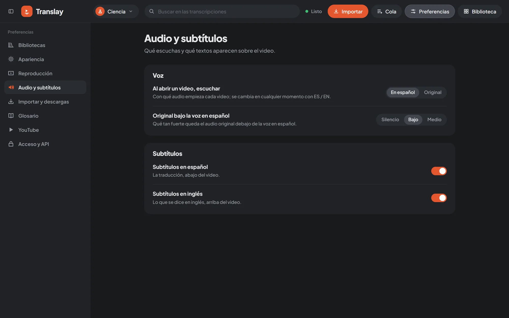

import { Aside } from "@astrojs/starlight/components";

**Preferencias** (Preferences), in the header, opens its own screen: the sections on the left and, on the right, the page for the selected section, with its options grouped and a description of each. Yes/no options are switches; the rest are buttons to choose an option. Changes apply instantly, with no save button. Tapping **Preferencias** again takes you back to the video or the library.

They are saved on the server (`data/prefs.json`) and apply to all tabs and devices. Some belong to each library and are saved in it (see [Libraries](../libraries/#what-each-one-stores)). Only the owner can change them.

The full table, with each option and its default value, is in the [preferences reference](../../reference/preferences/).

## Libraries

**Bibliotecas** (Libraries): your libraries as cards, with their folder: open them, edit them, change their pattern, remove them from the list or delete them. **Abrir carpeta** (Open folder) adds a folder that is already a library. All of this is explained in [Libraries](../libraries/).

## Appearance

**Apariencia** (Appearance). The **Modo** (Mode): light, dark or whatever your system uses. It belongs to each library, so you can have one light and another dark. With **Color de cada biblioteca** (Color of each library), buttons, progress and playback take the color of the open library.

## Playback

**Reproducción** (Playback). What happens when a video opens and when it ends: whether it starts on its own when ready, whether it continues with the next one in **Siguientes** (Up next), and whether it pauses when it reaches a part that doesn't have a Spanish voice yet. Also the default view (expanded or split), when the "Listo para reproducir" (Ready to play) indicator is shown, and what to do with a link you import while watching another video. How each one behaves: [Player](../player/#autoplay) and [Import](../import/#while-you-watch-a-video).

## Audio and subtitles

**Audio y subtítulos** (Audio and subtitles). Which audio each video starts with (Spanish or original; you switch later with ES / EN), how loud the original stays under the Spanish voice (silent, low or medium), and which subtitles are shown: Spanish at the bottom, English at the top, or none. The original's level is also used when you [export](../export/).

## Import and downloads

**Importar y descargas** (Import and downloads). What is done with what you import (download and translate, or download only), what is downloaded (video and audio, or audio only), in what order downloads run (the queue's or random), browser notifications, and whether channels appear in the library sidebar. **Al importar** (On import) and **Qué descargar** (What to download) belong to each library. Details in [Import](../import/#download-only-or-translate) and [Queue](../queue/#downloads).

## Glossary

**Glosario** (Glossary). Terms that are not translated or that are always translated the same way, specific to the open library. See [Glossary and search](../glossary-and-search/).

## YouTube

The session used to download: none, one from a browser, or a `cookies.txt` file, and the buttons to import it. See [YouTube](../youtube/#youtube-session).

## Access and API

**Acceso y API** (Access and API). Who gets in from other devices: the owner's password, local network access, each library's access (private, password-protected or public), API keys and webhooks. See [Access](../../integrations/access/), [API](../../integrations/api/) and [Webhooks](../../integrations/webhooks/).

## Performance

**Rendimiento** (Performance). Your machine, the model profile (automatic or the one you choose), VRAM, RAM and CPU limits, how long a video takes and warnings about why something is slow. See [Performance](../performance/).

## Trash

**Papelera** (Trash). What was deleted in the last 30 days, to restore it or delete it forever. See [Trash](../trash/).

<Aside>
Each section has its own address (`#/preferencias/<section>`), so reloading the page leaves you on the same one. Preferences are defined in `vt/prefs.py`.
</Aside>

## Desktop app

**App de escritorio** (Desktop app). Only in the Windows app: what the window does when you close it (quit or stay in the tray), the Main library folder, and logs. See [Desktop app](../desktop-app/).
