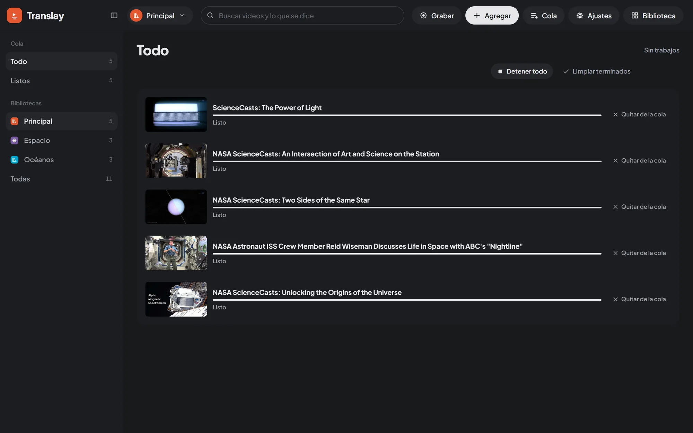

import { Aside } from "@astrojs/starlight/components";

Everything is processed in a single queue, on the server (`vt/processor.py`). It keeps working if you close the tab or reload, and it resumes where it left off if you restart the server. It is saved in `data/queue.json`.

## Order and priorities

1. **The video you are watching** always goes first. It is processed from your playback position to the end, then whatever came before; if you jump to an unprocessed part, processing jumps with you. When you go back to the library it stays in the queue like any other.
2. **Videos moved first**: **Hacer primero** (Do first), in the Queue, puts a video at the top. If it is already downloaded, it goes ahead of the background work in progress, which resumes later without losing progress. It lives only in the Queue: in the library it read like a way of sorting the library.
3. **Everything else**, in the order it was added.

If a stretch that was already recognized is missing its translation or voice (because processing was interrupted), the queue completes it when it gets there.

## Stop

- **Detener todo** (Stop all) stops the whole queue: background processing and downloads (a download in progress stops and later continues where it was). The video you are watching keeps being processed and downloaded. If you stop it with no video open, the models leave the GPU immediately. **Continuar todo** (Continue all) resumes it.
- **Detener** (Stop), on each job, does the same for one video: it keeps its place and what was done, but it isn't downloaded or processed until you press **Continuar** (Continue). **Hacer primero** on a stopped video also resumes it.

The queue says «detenido» (stopped) and «en espera» (waiting) instead of «en pausa» (paused), and its jobs have no play button: next to a waiting job, a play button read like «resume the queue», when it opened the video.

## Queue panel and screen

The **Cola** (Queue) button in the header carries a number with what is pending in the open library. Tapping it opens a panel with the overall status, **Detener todo** or **Continuar todo**, exports, downloads in progress and the first 50 jobs. **Ver todo** (See all) opens the full screen. The panel closes when you tap anything outside it, the «Agregar» button included.

The Queue screen has the states on the left, with their counts, and the list on the right, 100 at a time:

| State | What it shows |
|---|---|
| **Todo** (All) | All jobs, with what downloads first. |
| **Descargando** (Downloading) | What is being downloaded, with percentage, speed and time remaining. |
| **Procesando** (Processing) | The job in progress, with its percentage. |
| **En cola** (Queued) | What is waiting for its turn. |
| **Descargados sin traducir** (Downloaded, not translated) | What was added with **Solo descargar** (Download only). They have **Procesar** (Process). |
| **Con error** (Failed) | What failed, with the reason. |
| **Listos** (Done) | What is finished. |

If you have more than one [library](../libraries/#queue-and-libraries), below you can choose which one's jobs to see, or **Todas** (All). If there are exports, they appear in their own section.

The header has **Detener todo** or **Continuar todo**, **Reintentar descargas** (Retry downloads, only while YouTube asks for verification) and **Limpiar terminados** (Clear finished), which removes from the list what is done, downloaded without translation and what failed. Each job has, depending on its state, **Detener** or **Continuar**, **Hacer primero** or **Procesar**, and **Quitar de la cola** (Remove from queue). Its title opens the video; right-clicking it offers the same plus **Abrir el video** (Open the video) and **Detener toda la cola** (Stop the whole queue).

## Downloads

Downloads run on a separate thread, one at a time and with a short random pause between them, so they don't look like a burst to YouTube. To avoid filling the disk, only a few videos ahead of what has already been processed are downloaded; videos moved first, ones you ask to open and ones imported with **Solo descargar** don't wait for that turn.

With Settings › Agregar y descargar › **Orden de las descargas** › **Aleatorio (variado)** (Settings › Add and download › Download order › Random (varied)), downloads come from anywhere in the queue; videos moved first still go first.

Each download shows its stage: first the video and then the audio (with percentage, speed and time remaining), then "uniendo" (merging) and "preparando" (preparing), while the tracks are joined and the audio to be processed is separated.

## If YouTube asks you to verify you are not a bot

After many downloads in a row, YouTube may ask for that verification. Translay does not mark the videos as failed: it pauses all downloads for 20 minutes, notifies you once and switches to a **careful mode**, with longer pauses between downloads and between requests. The Queue status says how many minutes remain.

When you import a new YouTube session or connect your account, downloads continue right away and normal mode returns. With the account connected, Translay renews it on its own and keeps going without the pause. **Reintentar descargas** also resumes them without waiting. How to import the session: [YouTube](../youtube/#youtube-session).

## Retries

A video that could not be downloaded waits 10 minutes before retrying ("Falló la descarga · se reintenta en unos minutos", meaning the download failed and will be retried in a few minutes). After 3 attempts it stays in **Con error**, with the reason in plain words (private, deleted, private playlist, session problem…). What retrying can't fix (a private, deleted, members-only or age-restricted video, or a link that needs an account) goes to **Con error** at once, and a notice tells you which video and why.

## Idle mode

The models use the GPU only while there is something to process. After a while without use they move to system memory and, a little later, the voice process shuts down and the GPU is free. When you open a video they load again right away; meanwhile the player says "Cargando modelos" (Loading models). The header doesn't show this state (it competed with adding and recording): the Queue panel says it («preparando los modelos», preparing the models; «procesando», «descargando» or «sin trabajos», no jobs), and the Queue button carries a dot while something is working. The header only shows a status when there is no connection with Translay or for something specific, like looking up a video or reading a playlist.

The details on timing and memory are in [GPU and idle](../../how-it-works/gpu-and-idle/).

<Aside>
With **Avisos del navegador** (Browser notifications; Settings › Agregar y descargar) you get a system notification when a download, a video, the whole queue or an export finishes, only if the tab is in the background. Several notifications in a row are merged into one.
</Aside>
