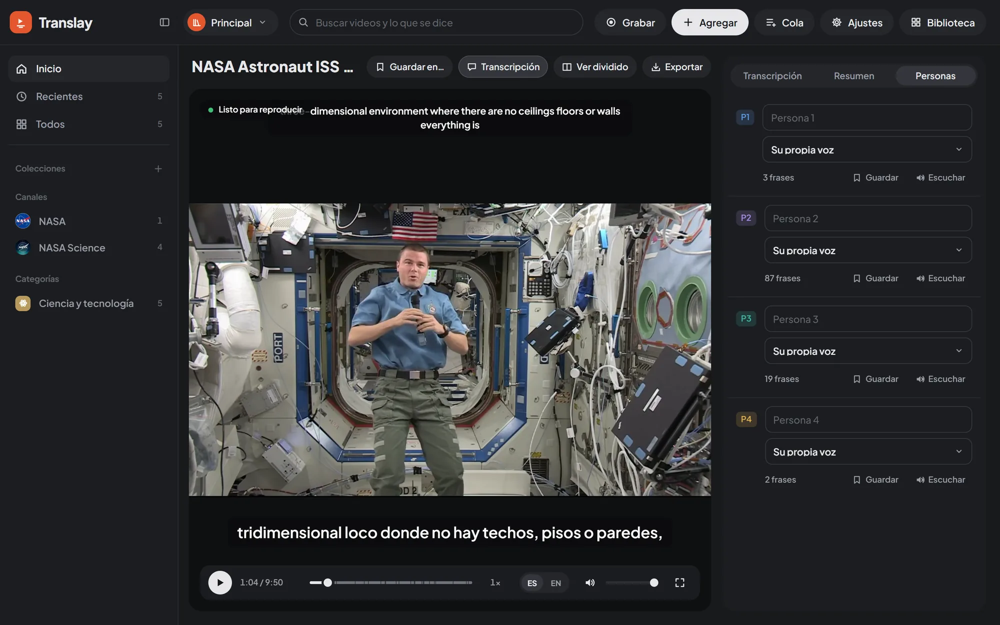

import { Aside } from "@astrojs/starlight/components";

The panel beside the video has up to four tabs: «Transcripción» (Transcript), «Resumen» (Summary), «Siguientes» (Up next) and «Personas» (People). «Resumen» appears once the video has a transcript; the last two, only when they have something to show. You hide it with the «Transcripción» button in the video bar or with the button next to the logo.

## Transcript

Each sentence takes a row with the original and the Spanish side by side (a single column, in its own language, if the video is only transcribed), the time it starts and, if more than one person speaks in the video, who says it. Sentences arrive as they are processed; a dash («—») marks those that don't have a translation yet. If a sentence's translation says the same as the original (a video in Spanish marked with another language), it shows once.

A stretch that hasn't been transcribed yet (you jumped ahead, or processing hasn't reached it) shows in its place among the sentences as a dashed row with its times and «Aún sin transcribir» (Not transcribed yet), so it doesn't look like something failed. While that part is playing and being processed it says «Transcribiendo esta parte» (Transcribing this part); a click jumps there. When it fills, the row disappears.

The sentence being heard is highlighted and the panel follows it automatically. If you scroll by hand, it stops following for a few seconds. One click on a sentence jumps to that moment in the video.

## Summary

The «Resumen» tab tells what the video was about: first a few paragraphs with the topic, how it develops and what it concludes; then all its important points, each with the minute where it's said. A click on a point jumps to that moment, and the point being watched is highlighted like the transcript's sentence. There is no fixed number of points: a long video has more (a 43-minute class came out with about 60, a 14-minute talk with about 24).

By default it's made when you ask for it: **Resumir** (Summarize) in the tab, once the transcription is complete (it appears as soon as it finishes, without leaving the video). The button shows how it goes («Resumiendo 40 %», Summarizing) and **Cancelar** (Cancel) stops it. With Settings › Resumen › **Resumir** › **Al procesar cada video** (Summarize › When each video is processed), every video is summarized on its own as soon as the queue finishes it. The first time, the summary model is downloaded (the button shows its progress).

The summary is in Spanish whatever the video's language, is saved with the video and is seen from every tab. Its context menu (right click) has **Copiar el resumen** (Copy), **Exportar el resumen** (Export, as TXT) and **Rehacer el resumen** (Redo, for example with another model).

It is made on your computer, with a small language model chosen for your machine (Settings › Resumen › **Modelo**). While it summarizes it has the GPU to itself: if the rest of Translay's models don't fit beside it, they are set aside and come back when it's done, so processing that's running waits a moment. How it works and how the models were chosen: [Summary](../../how-it-works/summary/).

## Comments

The **+** button on each sentence («Comentar esta frase», Comment on this sentence) opens a box to write a note. <kbd>Ctrl</kbd> + <kbd>Enter</kbd> saves it and <kbd>Esc</kbd> cancels. A sentence with comments shows how many it has on that same button, which is used to add another. Each comment carries its date and can be edited («Editar») or deleted («Eliminar»).

On the player's progress line, a little dot marks each commented sentence: hovering reads the comment and a click jumps to that sentence.

Comments are saved in the video's transcript, are visible in all open tabs, and are included in [search](../glossary-and-search/#search) and in the transcript that is [exported](../export/) as TXT.

## People

Translay tells apart the people who speak by their voice and dubs each one with their own cloned voice. The «Personas» tab appears as soon as the video has any identified, with one row per person (P1, P2…) and how many sentences they say.

In each row you can:

- **Name them.** The name replaces «P1» in the transcript and in the exported TXT.
- **Choose their Spanish voice.** «Su propia voz» (Their own voice) (or «Su voz (aún sin referencia)» (Their voice, no reference yet), if there isn't yet a clean enough sample of theirs), another person's voice from the same video, or that of a person saved in the library. When you change it, their sentences are dubbed again in the queue.
- **«Escuchar»** (Listen) the reference voice being used. The same button pauses it.
- **«Guardar»** (Save) the person in the library, with their name and voice. If one with the same name is already saved, the button says «Actualizar voz» (Update voice).

## Saved people

A saved person stays in the open library (`people/` folder) and appears in the voice selector of any video in that library, in the group «Guardadas en» (Saved in) plus the library's name. It is useful so that someone who appears in several videos always sounds the same, or to give one person another's voice.

At the end of the tab is the list of saved people, each with «Escuchar» and «Olvidar» (Forget). When you forget a person, videos that used their voice go back to each person's own voice when they are redone.

<Aside>
How each person's voice reference is built and how it is cloned: [Voice](../../how-it-works/voice/).
</Aside>
