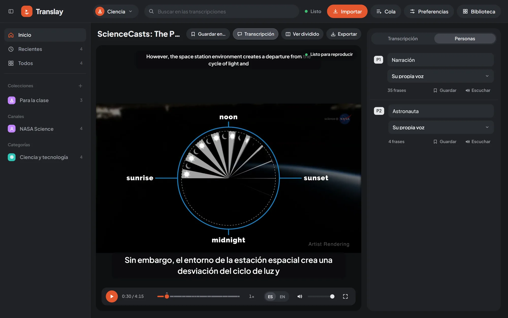

import { Aside } from "@astrojs/starlight/components";

The panel beside the video has up to three tabs: «Transcripción» (Transcript), «Siguientes» (Up next) and «Personas» (People). The last two appear only when they have something to show. You hide it with the «Transcripción» button in the video bar or with the button next to the logo.

## Transcript

Each sentence takes a row with English and Spanish side by side, the time it starts and, if more than one person speaks in the video, who says it. Sentences arrive as they are processed; a dash («—») marks those that don't have a translation yet.

The sentence being heard is highlighted and the panel follows it automatically. If you scroll by hand, it stops following for a few seconds. One click on a sentence jumps to that moment in the video.

## Comments

The **+** button on each sentence («Comentar esta frase», Comment on this sentence) opens a box to write a note. <kbd>Ctrl</kbd> + <kbd>Enter</kbd> saves it and <kbd>Esc</kbd> cancels. A sentence with comments shows how many it has on that same button, which is used to add another. Each comment carries its date and can be edited («Editar») or deleted («Eliminar»).

On the player's progress line, a little dot marks each commented sentence: hovering reads the comment and a click jumps to that sentence.

Comments are saved in the video's transcript, are visible in all open tabs, and are included in [search](../glossary-and-search/#searching-transcripts) and in the transcript that is [exported](../export/) as TXT.

## People

Translay tells apart the people who speak by their voice and dubs each one with their own cloned voice. The «Personas» tab appears as soon as the video has any identified, with one row per person (P1, P2…) and how many sentences they say.

In each row you can:

- **Name them.** The name replaces «P1» in the transcript and in the exported TXT.
- **Choose their Spanish voice.** «Su propia voz» (Their own voice) (or «Su voz (aún sin referencia)» (Their voice, no reference yet), if there isn't yet a clean enough sample of theirs), another person's voice from the same video, or that of a person saved in the library. When you change it, their sentences are dubbed again in the queue.
- **«Escuchar»** (Listen) the reference voice being used. The same button pauses it.
- **«Guardar»** (Save) the person in the library, with their name and voice. If one with the same name is already saved, the button says «Actualizar voz» (Update voice).

## Saved people

A saved person stays in the open library (`people/` folder) and appears in the voice selector of any video in that library, in the group «Guardadas en» (Saved in) plus the library's name. It is useful so that someone who appears in several videos always sounds the same, or to give one person another's voice.

At the end of the tab is the list of saved people, each with «Escuchar» and «Olvidar» (Forget). When you forget a person, videos that used their voice go back to each person's own voice when they are redone.

<Aside>
How each person's voice reference is built and how it is cloned: [Voice](../../how-it-works/voice/).
</Aside>
