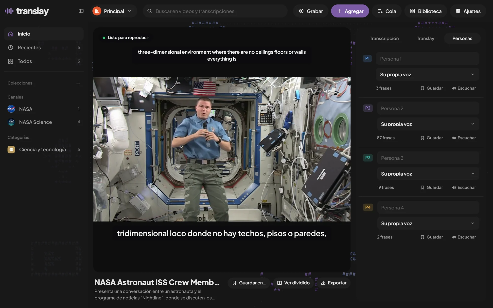

import { Aside } from "@astrojs/starlight/components";

The panel beside the video has up to four tabs: «Transcripción» (Transcript), «Resumen» (Summary), «Siguientes» (Up next) and «Personas» (People). «Resumen» appears once the video has a transcript; the last two, only when they have something to show. You hide it with the «Transcripción» button in the video bar or with the button next to the logo.

## Transcript

Each sentence takes a row with the original small on top and the Spanish below, in both views (only the original, in its own language, if the video is only transcribed), the time it starts and, if more than one person speaks in the video, who says it. Sentences arrive as they are processed; a dash («—») marks those that don't have a translation yet. If a sentence's translation says the same as the original (a video in Spanish marked with another language), it shows once.

A stretch that hasn't been transcribed yet (you jumped ahead, or processing hasn't reached it) shows in its place among the sentences as a dashed row with its times and «Aún sin transcribir» (Not transcribed yet), so it doesn't look like something failed. While that part is playing and being processed it says «Transcribiendo esta parte» (Transcribing this part); a click jumps there. When it fills, the row disappears.

The sentence being heard is highlighted and the panel follows it automatically. If you scroll by hand, it stops following for a few seconds. One click on a sentence jumps to that moment in the video.

What is written in the video and is worth having at hand (code blocks, commands, links, emails, social handles and code comments with their translation) appears in its place among the sentences, as a box with its type and time: one click jumps there and the copy button copies it as is. A block typed live in the video shows only in its complete version. See [Text in the video](../../how-it-works/screen-text/).

### Copy for an agent

**Copiar para un agente** (Copy for an agent), in the right-click menu of the video, of a sentence, of an element or of a video card, copies the whole video as Markdown, ready to paste into ChatGPT, Claude or any other agent: title, link and length, how far you watched (from the player), the summary, each sentence with its time and person and its translation below, your comments, and what was written on screen with the moments it appears. The same document comes from `GET /api/v1/videos/{id}/context`.

## Agent

The second tab is the video's agent, with the name you give it (Settings › Agente; «Translay» by default). Before the first question it shows what it can do as chips («Encontrar un momento», «Explicar un concepto», «Lo que me falta», «Código y comandos», «Preguntas de repaso», «Qué significa una palabra»): some ask right away and others leave the question started in the box to finish it. It also does things, instantly and even while turned off, each with its card in the conversation: «exporta esto para Claude» (a card with the whole video in Markdown, **Copiar** and **Descargar .md**), «llévame al minuto 3:15» or «llévame a donde explica X» (it jumps there), «pon los subtítulos en inglés» or «quita los subtítulos», «guarda este video en Python» and «avísame cuando hablen de precios» (it marks those moments on the progress bar and shows a notice when you reach each one). While it answers, it shows each step (loading the model, reading the video, writing). Hovering over a message shows its time and a button to copy it, and each finished answer ends with a green check. Right-clicking the progress bar offers «Preguntar a Lumi sobre 1:23» (Ask about that moment): the moment shows above the box as a mention, with its X, and the next question goes about it; also «Ir a» and «Copiar el momento». You can keep asking while it answers: new questions wait «En cola» (they can be removed) and are asked one after another. Ask it anything about the video: what is said, what appears written, in which minute something happens or what you still have to watch. It knows how far you've watched. Each moment in its answers (`[3:15]`) is a button that jumps there, and code and commands come with the colors of your code theme. Suggestions under the conversation change with the video (for example «¿Qué comandos se usan?» if it shows a terminal). <kbd>Enter</kbd> asks, <kbd>Shift</kbd> + <kbd>Enter</kbd> adds a line and the same button stops an answer at once, even while it is still reading the video: what it wrote so far stays, marked «Detenida» (Stopped), and **Continuar** (Continue) picks it up from there. The microphone button dictates: talk, tap it again (or wait a minute) and what you said is written in the box with Translay's own Whisper, ready to review and send. The browser asks for the microphone the first time; from another device it only appears over a secure connection (HTTPS).

It runs on your computer, without internet: the first question downloads its engine and model (the answer shows the progress), and from then on it answers in seconds. In **Ajustes › Agente** (Settings › Agent) you choose its name, avatar and color, write in **Estilo de respuesta** (Response style) how it should answer, in your own words (tone, length, who it talks to) and, if you want, choose its model and the **Dispositivo** (Device) it runs on (**Automático**, **Tarjeta gráfica**, **Integrada** or **Procesador**: Automatic, Graphics card, Integrated or Processor). The model list is grouped by compatibility with your computer (**Recomendado**, **Compatibles**, **Lentos en este equipo**, **Necesitan más memoria**), and each model says how well it answered in the lab (Excelente, Muy buena, Buena, Básica, or «Poco confiable» if it made up answers to trick questions) and its size or «descargado». Under the list, the model that will be used says «Descargado» or has a **Descargar** button with the progress on it, so the first question doesn't wait; agent models are deleted in [Storage](../storage/#models). The brush button in the agent's bar opens the same name, avatar, color and tone without leaving the video, and the changes show at once in the conversation; its answers and their moments take the agent's color. A sample video beside the options, there and in Settings (a summary with chapters, terms and resources, and a few questions), shows how it will look while you change them. The conversation is saved with the video; right click on a message copies it, asks again or clears the conversation. How it works: [Agent](../../how-it-works/agent/).

## Summary

The summary is the first card of the agent's tab: **Generar el resumen** (Generate the summary), among the agent's suggestions, makes it. It is written with what is said and what appears on screen: an overview of the video, **Ideas clave** (Key ideas), **Capítulos** (Chapters) with their points and the minute of each, **Conceptos clave** (Key terms) and **Recursos del video** (Video resources: the links, commands and code shown in the video). A click on a chapter or a point jumps to that moment, and the point being watched is highlighted like the transcript's sentence. Its question suggestions become the agent's, so they work even while the agent is off.

By default it is made on its own when each video is processed; with Settings › Agente › **Resumir** › **Manualmente** (Manually) it is made when you ask for it, once the transcription is complete (it appears as soon as it finishes, without leaving the video). The button shows how it goes («Resumiendo 40 %», Summarizing) and **Cancelar** (Cancel) stops it. The first time, the agent's model is downloaded (the button shows its progress).

The summary is in Spanish whatever the video's language, is saved with the video and is seen from every tab. Its context menu (right click) has **Copiar el resumen** (Copy), **Exportar el resumen** (Export, as TXT) and **Regenerar el resumen** (Regenerate, for example with another model).

It is made on your computer, with the agent's model (Settings › Agente › **Modelo**). While it summarizes it has the GPU to itself: if the rest of Translay's models don't fit beside it, they are set aside and come back when it's done, so processing that's running waits a moment. How it works: [Agent › The full summary](../../how-it-works/agent/#the-full-summary).

## Comments

The **+** button on each sentence («Comentar esta frase», Comment on this sentence) opens a box to write a note. <kbd>Ctrl</kbd> + <kbd>Enter</kbd> saves it and <kbd>Esc</kbd> cancels. A sentence with comments shows how many it has on that same button, which is used to add another. Each comment carries its date and can be edited («Editar») or deleted («Eliminar»).

On the player's progress line, a little dot marks each commented sentence: hovering reads the comment and a click jumps to that sentence.

Comments are saved in the video's transcript, are visible in all open tabs, and are included in [search](../glossary-and-search/#search) and in the transcript that is [exported](../export/) as TXT.

## People

Translay tells apart the people who speak by their voice and dubs each one with their own cloned voice. The «Personas» tab appears as soon as the video has any identified, with one row per person (P1, P2…) and how many sentences they say. Each person has their own color, the same on their P1, P2… and on their name in the transcript, so you can follow who speaks at a glance.

In each row you can:

- **Name them.** The name replaces «P1» in the transcript and in the exported TXT.
- **Choose their Spanish voice.** «Su propia voz» (Their own voice) (or «Su voz (aún sin referencia)» (Their voice, no reference yet), if there isn't yet a clean enough sample of theirs), another person's voice from the same video, or that of a person saved in the library. When you change it, their sentences are dubbed again in the queue.
- **«Escuchar»** (Listen) the reference voice being used. The same button pauses it.
- **«Guardar»** (Save) the person in the library, with their name and voice. If one with the same name is already saved, the button says «Actualizar voz» (Update voice).

## Saved people

A saved person stays in the open library (`people/` folder) and appears in the voice selector of any video in that library, in the group «Guardadas en» (Saved in) plus the library's name. It is useful so that someone who appears in several videos always sounds the same, or to give one person another's voice.

At the end of the tab is the list of saved people, each with «Escuchar» and «Olvidar» (Forget). When you forget a person, videos that used their voice go back to each person's own voice when they are redone.

<Aside>
How each person's voice reference is built and how it is cloned: [Voice](../../how-it-works/voice/).
</Aside>
