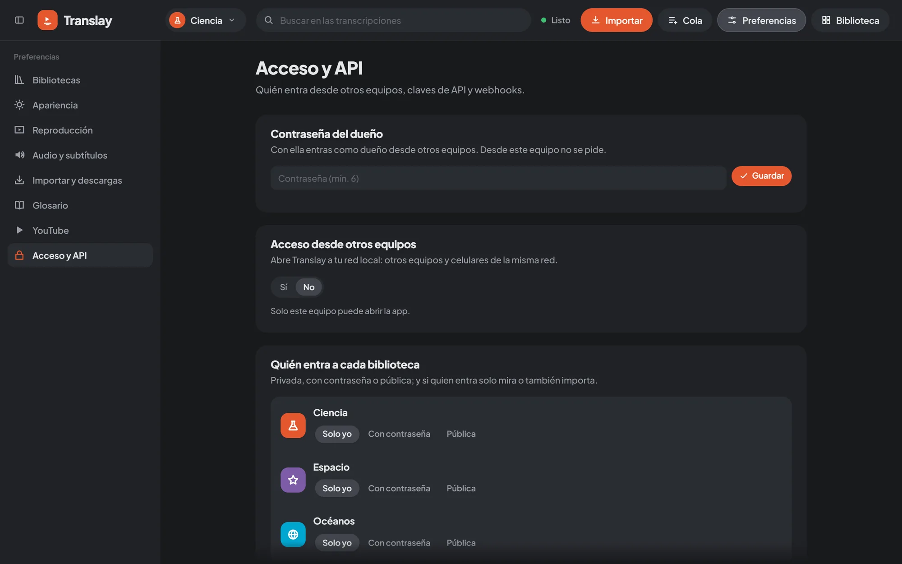

import { Aside, Steps } from "@astrojs/starlight/components";

Translay distinguishes between the owner, who can do everything, and guests, who get into specific libraries. Everything is configured in **Preferencias → Acceso y API** (Preferences → Access and API), which only the owner can see.



## The owner

You are the owner if you connect **from the same computer where the app runs**: the connection comes from `127.0.0.1` (or `::1`), requests the app as `localhost`, `127.0.0.1` or `[::1]` (so a domain that points to your computer, known as *DNS rebinding*, does not count as local), and carries none of these proxy headers:

`X-Forwarded-For` · `X-Real-IP` · `Forwarded` · `CF-Connecting-IP` · `X-Forwarded-Host`

That way you get in without a password. From any other computer, the owner signs in with the **owner password** (**contraseña del dueño**).

<Aside type="caution" title="Tunnels count as remote">
A tunnel such as Cloudflare Tunnel or ngrok runs on the same computer, so its connection also arrives from `127.0.0.1`. What gives it away are the headers it adds (`CF-Connecting-IP`, `X-Forwarded-For`): that is why anyone coming in through a tunnel is a remote visitor and needs a password.

A local proxy that does **not** add any of those headers (an SSH port forward, `socat`, or an nginx without `proxy_set_header X-Forwarded-For`) would make anyone pass as the owner. If you put something in front of Translay, check that it adds `X-Forwarded-For`.
</Aside>

### Owner password

In **Preferencias → Acceso y API → Contraseña** (Password), type one of at least 6 characters and click **Guardar** (Save), or **Cambiar** (Change) if there was already one.

- Without a password, you can only get in as the owner from this computer; the sign-in screen on other computers explains this.
- **Cambiar** (Change) or **Quitar contraseña** (Remove password) closes the owner sessions open on other computers. Guest sessions to libraries stay as they are.
- From another computer, **Cerrar sesión** (Sign out) deletes the session on the server (`POST /api/auth/logout`).

### Set it at startup

`--owner-password` (or the `TRANSLAY_OWNER_PASSWORD` variable) sets the owner password every time the server starts. If the stored one is different, it replaces it and closes the open owner sessions.

```sh
python run.py --owner-password "a-long-password"
# or
TRANSLAY_OWNER_PASSWORD="a-long-password" python run.py
```

With the variable defined, whatever you change or remove in Preferencias lasts until the next startup: then the variable's value applies again.

## Docker

Inside a container, connections arrive from the Docker network, never from `127.0.0.1`, so nobody is the owner without a password. That is why `docker-compose.yml` requires `TRANSLAY_OWNER_PASSWORD` in `.env` and won't start without it. The steps are in [Docker](../../getting-started/docker/).

In Docker, who can reach the app is decided by how the port is published, not by the **Acceso desde otros equipos** (Access from other computers) option:

- `-p 8765:8765` (or `"8765:8765"` in `docker-compose.yml`) opens it to the whole network of the computer.
- `-p 127.0.0.1:8765:8765` leaves it for this computer only, which still gets in with the password.

## Sessions

When you sign in, the server stores a `vt_s` cookie with a random token, `HttpOnly` and `SameSite=Lax`, that lasts **30 days** from the last sign-in (it is not renewed with use).

A single cookie can count as the owner and as a guest of several libraries at once: each library password you type is added to your session.

## Who gets into each library

In **Preferencias → Acceso y API → Bibliotecas** (Libraries), each library has its own visibility:

| Visibility | In the app | Who gets in |
| --- | --- | --- |
| `privada` | Solo yo (Only me) | Only the owner. This is the default. |
| `clave` | Con contraseña (With password) | Anyone with the link and the password of that library. |
| `publica` | Pública (Public) | Anyone who reaches the app. |

And, if it is not private, what the person who gets in can do:

| Permission | In the app | What it includes |
| --- | --- | --- |
| `ver` | Solo ver (View only) | View videos, search transcripts and export. |
| `importar` | Ver e importar (View and import) | The above, plus adding videos and sending them to the queue. |

Changes take effect instantly: if you remove someone's access to the library they have open, their tab closes.

### Library link

Each library has its own link, `/b/<id>`, which appears with the **Copiar enlace** (Copy link) button when the visibility is not private. It opens the app directly in that library. If the person opening it doesn't have access to anything yet:

- with a `clave` library, the app asks for that library's password (and, if there is an owner password, offers to sign in as the owner);
- with a `privada` one, it only lets them in with the owner password;
- in both cases it lists the public libraries, if there are any.

If **Acceso desde otros equipos** is on and you open Preferencias from this computer, the link uses the local network address instead of `localhost`, so it works when you share it.

### Change a library's password

When you save a new password for a `clave` library, anyone who got in with the old one loses access at that moment and has to type the new one. Changing only the permission (`ver` / `importar`) does not kick them out.

To switch a library to `clave` for the first time you have to give it a password; until it has one, the change isn't saved. If it goes back to `clave` from another visibility with the password it already had, those who got in before have to type it again.

## Who can do what

| | Owner | "Solo ver" guest | "Ver e importar" guest | Read key | Write key |
| --- | --- | --- | --- | --- | --- |
| View, search and export | Yes | Yes | Yes | Yes | Yes |
| Import and send to the queue | Yes | No | Yes | No | Yes |
| Delete videos, change the glossary, remove from the queue | Yes | No | No | No | Yes |
| Pause or resume the queue | Yes | No | No | No | Only if it is for all libraries |
| Collections, comments and people | Yes | No | No | No | No |
| Preferences, access, keys and webhooks | Yes | No | No | No | No |
| See each library's folder | Yes | No | No | No | No |

Guests and keys only reach the libraries assigned to them. API keys are explained in [REST API](../api/).

## Access from other computers

By default the server listens only on `127.0.0.1:8765`: nobody else can reach it. In **Preferencias → Acceso y API → Otros equipos** (Other computers), choose **Sí** (Yes) so it also listens on every IPv4 address of the computer's local network (excluding `127.*` and `169.254.*`), on the same port.

<Steps>
1. Set an owner password, if you will sign in as the owner from another computer.
2. Under **Otros equipos**, choose **Sí**.
3. Copy one of the addresses shown (e.g. `http://192.168.1.20:8765`) and open it on the other computer or on your phone, connected to the same network.
</Steps>

The option is saved and applied again at startup; the console shows the addresses (`En la red: …`, "On the network: …"). If no address appears, the computer isn't connected to a local network.

If you start with `--host 0.0.0.0`, the server already listens on all addresses and this option doesn't change who can reach it.

## How secrets are stored

| What | How | Where |
| --- | --- | --- |
| Owner password | scrypt (N = 2¹⁴, r = 8, p = 1) with a random 16-byte salt | `data/auth.json` |
| Each library's password | scrypt, same as the owner's | that library's `vault.json` |
| Session tokens | SHA-256 of the token | `data/auth.json` |
| API keys | SHA-256 of the key; shown in full only once | `data/auth.json` |
| Webhook secrets | In plain text (needed for signing) | `data/webhooks.json` |

No password or key is stored in plain text. Each sign-in attempt waits 0.4 s before answering and, after 10 failed attempts in 10 minutes, that computer has to wait (`429`). Signing in always hands out a new token: one that someone planted beforehand can't be used to sneak into your session.

## Other websites

The browser sends the session cookie to `localhost:8765` even when the request is made by another page, and from this computer you don't even need the cookie to be the owner. So that any site you open can't use Translay on your behalf, the server requires the `Origin` header to be the app itself on:

- the interface WebSocket (`/ws`);
- every request that changes something (`POST`, `PUT`, `DELETE`): the API, sign-in, file uploads and cookies.

If the origin is different (or `null`), it responds `403 Origen no permitido` ("Origin not allowed"). This doesn't apply to:

- requests without `Origin`, such as those from `curl` or a script: they don't come from a browser;
- requests with `Authorization: Bearer …`: another page doesn't know your key;
- reads (`GET`): the browser doesn't let another page read the response.

The origin is valid if it matches the request's `Host` or the `X-Forwarded-Host` that a proxy adds. If you put Translay behind a proxy or tunnel that changes the `Host` and doesn't add `X-Forwarded-Host`, declare the public address:

```sh
python run.py --allow-origin https://translay.mydomain.com
# or
TRANSLAY_ORIGINS=https://translay.mydomain.com python run.py
```

## Security recommendations

- **On the local network everything travels over HTTP, unencrypted.** Passwords, the session cookie and API keys can be read from the same network. Use it on trusted networks, not on a café's wifi.
- **To get in from the internet, don't open the port on your router.** Use a tunnel or a proxy with HTTPS (Cloudflare Tunnel, ngrok, Caddy) that adds `X-Forwarded-For` toward port `8765`, and set a long owner password.
- `publica` libraries are open to anyone who reaches the app; behind a tunnel, that means anyone on the internet. Prefer `clave`.
- Give `importar` only to people you trust: every imported video takes up disk space and GPU time.
- Create API keys for a single library and read-only whenever that is enough, and revoke the ones you no longer use.
